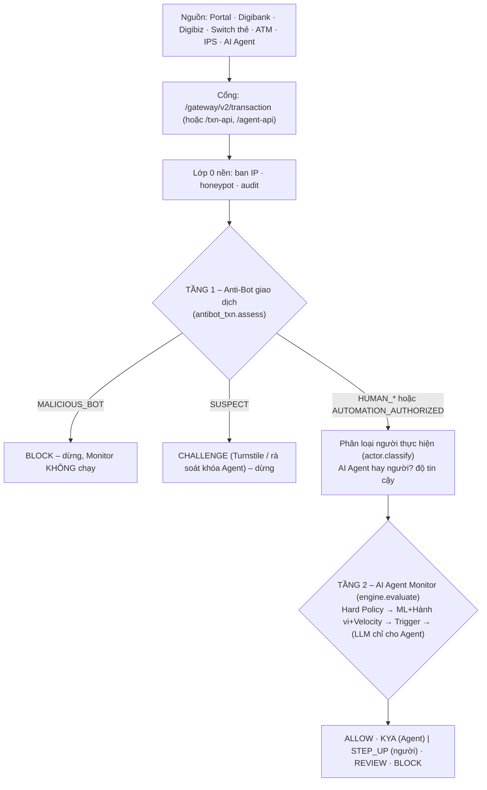

# Kiến trúc v2: Anti-Bot trước, AI Agent Monitor sau (tuần tự)

## Nguyên tắc
1. **Mọi giao dịch** – FX, thẻ (mọi mạng/loại/phương thức), chuyển tiền, mua sắm online, QR, hóa đơn – đi **qua Anti-Bot trước**, **rồi mới** tới AI Agent Monitor.
2. Tầng 1 (Anti-Bot) trả lời: *bot thật hay người thật hay tự động hóa được phép (AI Agent có khóa)?*
3. Tầng 2 (Monitor) trả lời: *người thực hiện là AI Agent hay người? giao dịch này có rủi ro gian lận/bất thường không?*
4. Thứ tự được **ép bằng mã** (`agentmon/pipeline.py: process`), mọi cổng đều gọi hàm này; có test chứng minh Monitor không chạy khi tầng 1 chặn.

## Các cổng vào (đều đi qua pipeline)
| Cổng | Người gọi | Khóa | Ghi chú |
|---|---|---|---|
| `POST /gateway/v2/transaction` | Agent hoặc hệ thống nguồn | `Authorization: Bearer agk_…` hoặc `X-Source-Key: skx_…` | Cổng thống nhất, trả `stage` (ANTIBOT/MONITOR) |
| `POST /agent-api/v1/monitor/action` | AI Agent | Bearer agk_ | Giữ tương thích |
| `POST /txn-api/v1/monitor/transaction` | Hệ thống nguồn (portal, Digibank/Digibiz, switch thẻ, ATM, IPS) | X-Source-Key | Giữ tương thích; kết quả STEP_UP báo lại qua `/transactions/<id>/step-up-result` |

Anti-Bot **web gốc** (`/api/*`: đăng nhập, phiên, báo giá FX, PoW, Turnstile) vẫn bảo vệ giao diện web; điểm bot của phiên web được kênh nguồn gửi vào tầng 1 qua `session.anti_bot_score` như một tín hiệu.

## Tầng 1 – nhận diện bot thật và người
Xem bảng điều kiện đầy đủ trong tài liệu hướng dẫn (mục Anti-Bot). Tóm tắt: sổ chứng cứ cộng điểm **bot** và **người**; chặn cứng chỉ khi có bằng chứng tấn công rõ (replay, dò thẻ, trang trại thiết bị, IP cấm…) hoặc bằng chứng bot mạnh mà không có bằng chứng người; trường hợp giữa là **thử thách**; Agent hợp lệ **không** bị phạt vì hành vi tự động.

## Tầng 2 – người thực hiện và quyết định
* `actor.classify`: AI Agent / người + độ tin cậy; `< 0,65` → `ACTOR_UNVERIFIED` (xác minh bổ sung).
* Người: không gọi LLM, KYA đổi thành **STEP_UP** (OTP hoặc sinh trắc do kênh nguồn thực hiện); Agent: KYA qua Authenticator của khách.
* `session_risk` (đặc trưng ML) = điểm bot của tầng 1.

## FX và thanh toán cùng lúc
Hai phân hệ, một engine, mô hình riêng; **dùng chung số dư**; lệnh chờ xác minh giữ chỗ; kiểm tra rồi ghi là nguyên tử giữa các tiến trình (`flock`; nhiều máy cần khóa tư vấn PostgreSQL). Velocity xuyên phân hệ (`cross_n5`) và xuyên người thực hiện (`cross_actor_n10`).

## Hồ sơ triển khai
`DEPLOY_PROFILE=demo|pilot|production` (xem `agentmon/profiles.py`, `GET /api/agent/hq/readiness`). Chỉ hồ sơ production được khai báo rõ mới có cổng **từ chối khởi động** khi còn BLOCKER.

## Bổ sung v2.1
* **Danh tính tại ATM:** `atm_identity.assess` (sau Hard Policy đầu vào, trước chấm điểm) dùng tín hiệu camera AI + hành vi ATM; hard-block khi khuôn mặt không khớp/giả mạo/không có người; STEP_UP `APP_CONFIRM` khi chưa chắc chắn; Tầng 1 chặn giả mạo sinh trắc và ATM không có người.
* **Ensemble:** Tầng 1 thêm mô hình bot–người; Tầng 2 thêm gradient boosting (ý kiến thứ hai), chuỗi hành vi, đồ thị liên kết. Chế độ `shadow` chỉ ghi nhận; mọi mô hình bổ sung chỉ nâng cảnh báo.
* **Bộ tiêu chí:** `docs/CRITERIA.md`.
