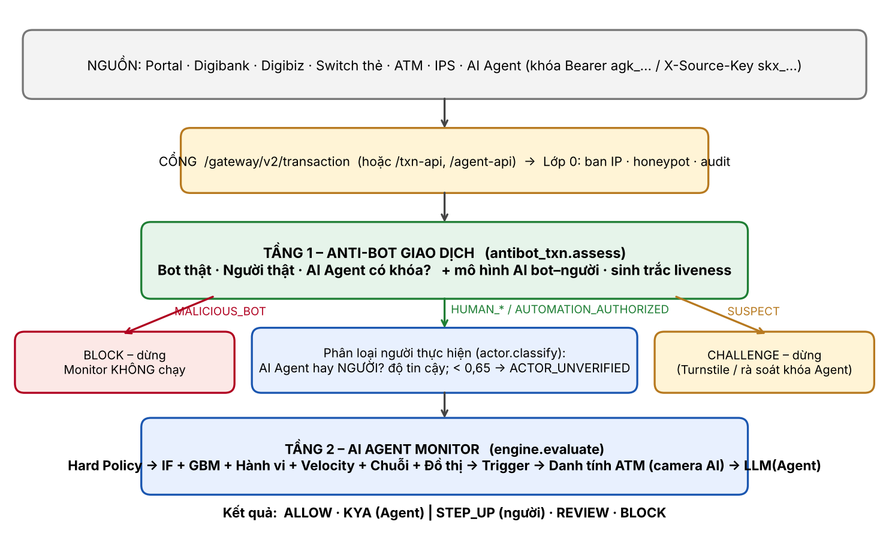

# 1. Giới thiệu và phạm vi

## 1.1 Mục tiêu của tài liệu
Tài liệu hướng dẫn **cài đặt, cấu hình, vận hành, kiểm thử và đánh giá rủi ro** của mô hình giám sát giao dịch gồm hai tầng bảo vệ nối tiếp:

* **Tầng 1 – Anti-Bot giao dịch:** phân biệt **bot thật** với **người thật** và với **tự động hóa được phép** (AI Agent đã đăng ký, có khóa hợp lệ).
* **Tầng 2 – AI Agent Monitor:** xác định người thực hiện là **AI Agent hay người**, rồi chấm điểm rủi ro gian lận/bất thường và ra quyết định.

Mọi giao dịch – **FX, thẻ (mọi mạng, mọi loại, mọi phương thức: debit, credit, prepaid, ảo, doanh nghiệp), chuyển tiền, mua sắm online, QR, hóa đơn, thanh toán sao kê thẻ tín dụng, rút tiền ATM, ví điện tử** – đều đi qua Tầng 1 **trước**, rồi mới tới Tầng 2.

Tại **ATM**, hệ thống phối hợp **camera AI nhận diện khuôn mặt** (đã đăng ký sinh trắc) để phân biệt *chính chủ tự rút tiền* với *người khác dùng thẻ* và với *AI Agent/tự động hóa rút tiền từ xa*; khi chưa chắc chắn, chủ thẻ xác nhận trên điện thoại (KYA/KYC). Phía sau là **bộ nhiều mô hình AI** phối hợp (Isolation Forest, gradient boosting, mô hình bot–người, chuỗi hành vi, đồ thị liên kết, Face-AI, LLM Critic).

## 1.2 Nguyên tắc thiết kế
1. **Anti-Bot trước, Monitor sau** – ép bằng mã (`agentmon/pipeline.py`), có test chứng minh Monitor không chạy khi Tầng 1 chặn.
2. **Chặn cứng chỉ khi có bằng chứng rõ;** trường hợp trung gian là **thử thách**, không chặn (giảm chặn nhầm người thật).
3. **Tự động hóa của AI Agent hợp lệ là bình thường** – không bị phạt vì nhịp đều hay thiếu chuột/bàn phím.
4. **Không tin khai báo, quan sát hành vi:** người khai báo nhưng hành vi tự động bị nghi; khóa Agent mà có tương tác chuột/bàn phím bị rà soát.
5. **Hard Policy không bị ML/LLM ghi đè;** LLM chỉ được **nâng** mức rủi ro, và không chạy trên đường đi thời gian thực của người dùng.
6. **Giải thích được và kiểm toán được:** mỗi quyết định lưu trace đầy đủ, mã băm SHA-256, phiên bản mô hình.
7. **Nhiều mô hình, một quy tắc an toàn:** các mô hình AI bổ sung chỉ được **nâng** cảnh báo, không bao giờ hạ; mô hình học có giám sát chạy **bóng (shadow)** ở pilot/production cho tới khi kiểm chứng trên dữ liệu thật (mục 9).
8. **Sinh trắc có điều kiện:** chỉ lưu embedding mã hóa khi có đồng ý; vùng chưa chắc chắn dẫn tới xác nhận qua điện thoại, không chặn khách thật (mục 7).
9. **Trung thực về giới hạn:** mô hình huấn luyện trên dữ liệu tổng hợp; xem mục 15 và Danh mục rủi ro (mục 16).

## 1.3 Thuật ngữ

| Thuật ngữ | Ý nghĩa |
|--------------|--------------------------------------------------------|
| Anti-Bot | Lớp chống tự động hóa trái phép. Ở tài liệu này: Anti-Bot **cấp giao dịch** (tầng 1); khác với Anti-Bot web gốc bảo vệ đăng nhập/báo giá (`app/guard.py`). |
| AI Agent | Chương trình/AI tự động giao dịch thay khách hàng, đã đăng ký với ngân hàng và có khóa API `agk_…`. |
| Hệ thống nguồn | Hệ thống của ngân hàng gửi giao dịch của NGƯỜI sang Monitor: Portal, Digibank, Digibiz, Switch thẻ, Switch ATM, IPS. Khóa `skx_…`. |
| Bot thật / MALICIOUS_BOT | Tự động hóa không được phép: script, tấn công thẻ, replay, trang trại tài khoản. |
| KYA (Know Your Agent) | Xác minh của chủ tài khoản qua ứng dụng Authenticator khi Agent thực hiện giao dịch bất thường. |
| STEP_UP | Xác thực bổ sung (OTP hoặc sinh trắc học) cho giao dịch của NGƯỜI; kênh nguồn thực hiện, rồi báo kết quả. |
| Trigger | Điều kiện xác định bắt buộc xác minh, không phụ thuộc điểm ML. |
| Hard Policy | Luật chặn cứng (hạn mức, danh sách chặn, PCI, Agent chưa đăng ký…). |
| Hồ sơ triển khai | demo / pilot / production – tập cấu hình và điều kiện sẵn sàng khác nhau. |


# 2. Kiến trúc và luồng xử lý

## 2.1 Sơ đồ tổng thể


## 2.2 Các bước xử lý một giao dịch

| Bước | Thành phần | Việc làm | Kết quả có thể |
|----|--------------|----------------------------|-----------------------|
| 0 | Cổng + Lớp 0 | Xác thực khóa (`Bearer agk_…` hoặc `X-Source-Key skx_…`), giới hạn tốc độ, ban IP/honeypot, kiểm tra kiểu dữ liệu `session.*` | 401 sai khóa · 429 quá nhanh · 400 dữ liệu sai |
| 1 | Anti-Bot giao dịch | Sổ chứng cứ bot–người + mô hình AI bot–người + sinh trắc liveness + luật tấn công thẻ/replay/thiết bị | HUMAN_VERIFIED · HUMAN_LIKELY · AUTOMATION_AUTHORIZED → qua; SUSPECT → CHALLENGE; MALICIOUS_BOT → BLOCK |
| 2 | Phân loại người thực hiện | AI Agent hay người, độ tin cậy, kiểm tra chéo AGENT_ECHO | actor_type + confidence; < 0,65 → ACTOR_UNVERIFIED |
| 3 | Hard Policy | Hạn mức MIN(TSC, chi nhánh, Agent), danh sách chặn, đăng ký Agent, PCI, số dư, kill-switch (chỉ Agent) | Vi phạm → BLOCK ngay |
| 4 | Chấm điểm | ML (Isolation Forest) + Hành vi + Velocity → điểm cuối; ý kiến thứ hai (gradient boosting), chuỗi hành vi, đồ thị liên kết, danh tính ATM | Điểm 0–1 + tín hiệu bổ sung |
| 5 | Trigger + phân loại | Trigger xác định, luật thẻ, kiểu gian lận | Bắt buộc KYA/STEP_UP; FRAUD_SUSPECTED / ANOMALY / NORMAL |
| 6 | LLM Critic (chỉ Agent) | Nhận xét vùng xám, chỉ được NÂNG mức | Nâng ALLOW→KYA/REVIEW |
| 7 | Quyết định | Ngưỡng + trigger + fail-closed | ALLOW · KYA (Agent) · STEP_UP (người) · REVIEW · BLOCK |
| 8 | Ghi nhận | actions + trace + antibot_events + audit | Giải trình, kiểm toán |


## 2.3 Các cổng vào

| Cổng | Người gọi | Khóa | Ghi chú |
|-----------------|-----------|-----------------|-----------------------|
| `POST /gateway/v2/transaction` | Agent hoặc hệ thống nguồn | `Authorization: Bearer agk_…` hoặc `X-Source-Key: skx_…` | Cổng thống nhất; phản hồi có `stage` (ANTIBOT/MONITOR) |
| `POST /agent-api/v1/monitor/action` | AI Agent | Bearer agk_ | Giữ tương thích; đi qua pipeline |
| `POST /txn-api/v1/monitor/transaction` | Hệ thống nguồn | X-Source-Key | Giữ tương thích; đi qua pipeline |
| `POST /txn-api/v1/transactions/<id>/step-up-result` | Hệ thống nguồn | X-Source-Key | Báo kết quả OTP/sinh trắc |
| `GET /txn-api/v1/transactions/<id>` | Hệ thống nguồn | X-Source-Key | Xem kết quả (chỉ giao dịch của nguồn mình) |
| `/api/*` (web) | Trình duyệt người dùng | Phiên đăng nhập | Anti-Bot web gốc: PoW, Turnstile, báo giá FX; điểm bot của phiên web được kênh nguồn chuyển vào `session.anti_bot_score` |


## 2.4 Hệ thống nguồn và loại giao dịch được phép
Mỗi hệ thống nguồn chỉ được gửi đúng loại giao dịch của mình (gửi sai → 400).

| Nguồn | Tên | Loại giao dịch (`kind`) | Kênh mặc định |
|----------|--------------------|------------------------------|----------|
| PORTAL | Internet banking / Portal | FX_TRADE, TRANSFER, CARD_STATEMENT_PAYMENT | {"TRANSFER": "PORTAL", "CARD_STATEMENT_PAYMENT": "PORTAL"} |
| DIGIBANK | Digibank (khách cá nhân) | TRANSFER, BILL_PAYMENT, QR_PAYMENT, ONLINE_PURCHASE, CARD_STATEMENT_PAYMENT | DIGIBANK |
| DIGIBIZ | Digibiz (khách doanh nghiệp) | TRANSFER, BILL_PAYMENT, QR_PAYMENT, ONLINE_PURCHASE, CARD_STATEMENT_PAYMENT | DIGIBIZ |
| CARD_SWITCH | Switch thẻ (POS/CNP/ví) | CARD_PAYMENT, ONLINE_PURCHASE, WALLET_PAYMENT | theo giao dịch |
| ATM_SWITCH | Switch ATM | ATM_WITHDRAWAL | ATM |
| IPS_TRANSFER | Chuyển tiền liên ngân hàng (IPS/247) | TRANSFER | {"TRANSFER": "IPS"} |


## 2.5 Giao dịch của FX và thanh toán cùng lúc
* Hai phân hệ dùng chung một engine nhưng **mô hình, hạn mức riêng**; **dùng chung số dư**: FX giữ ký quỹ (`notional / đòn bẩy`), thanh toán giữ toàn bộ số tiền.
* Lệnh chờ KYA/REVIEW/STEP_UP **giữ chỗ số dư** nên hai lệnh đồng thời không dùng chung một khoản tiền (STEP_UP giữ 15 phút).
* Kiểm tra số dư rồi ghi là **nguyên tử giữa các tiến trình** (`RLock` + `flock`). Đã kiểm chứng bằng hai tiến trình đồng thời (số dư 30 triệu, mỗi lệnh 28 triệu): luôn đúng một lệnh giữ được số dư, số dư không âm. **Nhiều máy** cần khóa tư vấn PostgreSQL (chưa có).
* Tín hiệu chéo: `cross_n5` (≥ 4 lệnh ở phân hệ kia trong 5 phút → +0,15 velocity, kiểu `CROSS_DOMAIN_BURST`) và `cross_actor_n10` (người ↔ Agent cùng thao tác dồn dập → `ACTOR_CONFLICT`).


# 3. Bộ tiêu chí phân biệt BOT – AI AGENT – NGƯỜI

## 3.1 Nguyên tắc
Hệ thống **không** kết luận dựa trên một tín hiệu. Mỗi tiêu chí đóng góp **bằng chứng** cho phía bot hoặc phía người; AI Agent hợp lệ được nhận diện bằng **khóa + đăng ký** và **không bị phạt vì tự động hóa**. Ba câu hỏi được trả lời tuần tự:

1. **Có phải tự động hóa trái phép (bot thật) không?** – Tầng 1.
2. **Nếu là tự động hóa, có phải AI Agent đã đăng ký không?** – Tầng 1 (khóa hợp lệ) và Tầng 2 (độ tin cậy người thực hiện).
3. **Nếu là người, có phải CHÍNH CHỦ không (và giao dịch có đáng ngờ không)?** – Tầng 2 (sinh trắc tại ATM, thiết bị, hành vi, mô hình AI).

## 3.2 Ba ví dụ phân loại

| Tình huống | Bằng chứng nổi bật | Kết luận |
|--------------|--------------------------------|-----------------------|
| Script gọi API giả lập khách | User-Agent curl/python, header lạ, xác nhận sau 50 ms, không chuột/phím, điểm bot web 95, mô hình bot–người 0,99 | MALICIOUS_BOT → BLOCK ở Tầng 1; Monitor không chạy |
| AI Agent của khách gửi lệnh 24/7, nhịp đều | Khóa agk_ hợp lệ, Agent đã đăng ký/được duyệt, không có chuột/phím, nhịp đều | AUTOMATION_AUTHORIZED → qua Tầng 1; Tầng 2 chấm điểm như AGENT (KYA nếu bất thường) |
| Khách dùng ứng dụng Digibank chuyển tiền | Thiết bị chứng thực + đã gắn tài khoản, MFA 2 phút trước, chuột/phím tự nhiên, suy nghĩ 5 giây, liveness cao | HUMAN_VERIFIED → qua; Tầng 2 chấm điểm như NGƯỜI (STEP_UP nếu bất thường) |


## 3.3 Bảng tiêu chí đầy đủ
Cột **Tầng**: T1 = Anti-Bot giao dịch, T2 = AI Agent Monitor. Tham chiếu định hướng (không phải chứng nhận): NIST SP 800-63B (mức đảm bảo xác thực), ISO/IEC 30107-3 (phát hiện tấn công giả mạo sinh trắc – PAD), OWASP Automated Threats – OAT (Carding, Card Cracking, Cashing Out).


| ID | Tiêu chí | Trường đo | BOT thật | AI Agent hợp lệ | Người thật | Cách dùng trong hệ thống | Tầng |
|----|---------|---------|---------|---------|---------|---------------|----|
| K01 | Thông tin xác thực | credential, X-Source-Key, Bearer agk_ | Không có hoặc sai khóa | Khóa agk_… hợp lệ, Agent đã đăng ký và được duyệt | Phiên đăng nhập có MFA qua hệ thống nguồn (khóa skx_…) | Không có → BLOCK (NO_CREDENTIAL); khai báo AGENT/HUMAN suy ra từ loại khóa | T1 |
| K02 | Đăng ký và phạm vi quyền | agents.domains/kinds/limits | Không có đăng ký | Đăng ký nghiệp vụ, hạn mức, thử việc; giao dịch ngoài phạm vi bị chặn | Không cần đăng ký; hạn mức theo phân khúc | Hard Policy; thử việc 3 giao dịch đầu bắt buộc KYA | T2 |
| K03 | Thời gian suy nghĩ (từ hiện màn xác nhận đến bấm) | session.think_time_ms | < 300 ms hoặc đồng đều | Không áp dụng (không có màn hình) | ≥ 1,2 giây, biến thiên lớn | < 300 ms: bot +3; ≥ 1,2 giây kèm chuột/phím: người +3 | T1 |
| K04 | Nhịp gửi lệnh (hệ số biến thiên khoảng cách) | ab:cad (CV) | CV < 0,08 (metronome) | Đều là BÌNH THƯỜNG, không bị phạt | CV lớn, bất quy tắc | Người khai báo mà CV < 0,08 sau ≥ 8 lệnh/5 phút: bot +3 | T1 |
| K05 | Telemetry chuột/chạm/phím | pointer_events, key_events, scroll_events, focus_changes | Không có hoặc rất ít | Không có; nếu CÓ tương tác trên khóa Agent → nghi người dùng chung khóa | Có, theo phiên | Kênh trực tuyến thiếu telemetry: bot +2 (pilot/production); khóa Agent có tương tác → CHALLENGE | T1 |
| K06 | Entropy đường đi chuột và biến thiên nhịp phím | pointer_path_entropy, key_interval_cv | Thấp (đường thẳng, nhịp đều) | Không áp dụng | Cao, không đều | Đầu vào của mô hình AI bot–người (K15) | T1 |
| K07 | Hồ sơ header và User-Agent | header_score, User-Agent | Headless/curl/selenium/python-requests, header lạ | UA của thư viện/Agent (không bị phạt) | Giống trình duyệt/ứng dụng ngân hàng | UA tự động +4; header_score ≥ 40 +3; < 20 người +1 | T1 |
| K08 | Chứng thực thiết bị và thiết bị quen | device_attested, device_known | Không có | Không áp dụng | Có (App Attest/Play Integrity), thiết bị gắn với tài khoản | Attested người +3; known người +2; thiết bị mới + người nhận mới → xác thực bổ sung | T1+T2 |
| K09 | Uy tín IP/ASN | ip_reputation, client_ip | TOR/proxy/trung tâm dữ liệu | Máy chủ cố định (có thể là datacenter) | Dân cư/di động | TOR/PROXY/DATACENTER: bot +2; Agent từ TOR/PROXY → CHALLENGE | T1 |
| K10 | Replay, nonce, dấu thời gian | session.nonce, session.ts | Gửi lại yêu cầu bắt được | Mỗi yêu cầu có request_id duy nhất | Mỗi yêu cầu có nonce duy nhất | Nonce dùng lại hoặc lệch > 5 phút → BLOCK; production bắt buộc nonce | T1 |
| K11 | Độ mới của MFA và thử thách | mfa_age_s, pow_ok, turnstile_ok | Không qua được thử thách | Không áp dụng | MFA ≤ 15 phút, qua Turnstile/PoW | RECENT_MFA +2; CHALLENGE_PASSED +2; vượt thử thách sau nghi ngờ → qua với tin cậy thấp | T1 |
| K12 | Nhiều tài khoản dùng chung thiết bị/IP/người nhận | devcust, graphrisk.ring_size | ≥ 4 khách trên một thiết bị/24h | Một Agent phục vụ một khách | Thường 1–2 khách (gia đình) | Tầng 1: DEVICE_FARM; Tầng 2: đồ thị liên kết (LINKED_ACCOUNTS, FRAUD_RING) | T1+T2 |
| K13 | Vận tốc thẻ: dò BIN, dò thẻ, bão từ chối | ab:cards, ab:small, ab:decl | ≥ 5 thẻ/thiết bị; ≥ 6 giao dịch nhỏ; ≥ 60% bị từ chối | Không (một Agent một khách) | Rất hiếm | CARD_ENUMERATION, CARD_TESTING, DECLINE_STORM → BLOCK (OWASP OAT: Carding, Card Cracking) | T1 |
| K14 | Mô hình bot–người (gradient boosting) | botmodel.score | Xác suất cao | Không áp dụng | Xác suất thấp | ≥ 0,85: bot +3; ≥ 0,6: +2; ≤ 0,15: người +2 (chế độ bóng ở pilot/production) | T1 |
| K15 | Liveness và chống giả mạo (PAD) | biometric.liveness_score, injection_attack_score | Ảnh/video/mặt nạ/virtual camera/deepfake | Không có khuôn mặt | Liveness cao, không injection | Liveness ≥ 0,9: người +4; liveness < 0,5 hoặc injection ≥ 0,6 → BLOCK (ISO/IEC 30107-3) | T1+T2 |
| K16 | Khớp khuôn mặt chủ thẻ đã đăng ký | face_match_score \| face_embedding | Không khớp | Không áp dụng | Khớp ≥ 0,80 với mẫu đã đăng ký | Khớp: người +2; không khớp < 0,50 → BLOCK (người khác dùng thẻ); trung gian → xác nhận qua điện thoại (KYA) | T2 |
| K17 | Hiện diện vật lý trước ATM | biometric.face_present, camera_status | Giao dịch ATM không có người (relay/malware/rút từ xa) | AI Agent không thể đứng trước ATM → rút tiền mặt luôn cần chủ thẻ xác nhận | Có mặt, 1 khuôn mặt | NO_PERSON → BLOCK; nhiều khuôn mặt → STEP_UP; camera bị che → STEP_UP/REVIEW | T1+T2 |
| K18 | Nhịp nhập PIN và số lần sai | pin_entry_cv, pin_digits, pin_attempts | Nhịp đều như máy (CV < 0,05) | Không áp dụng | Biến thiên tự nhiên | ATM_PIN_AUTOMATED → xác thực bổ sung; PIN sai ≥ 2 lần +0,15 | T2 |
| K19 | Nhiều thẻ của nhiều chủ trên cùng ATM | actions.merchant (ATM) theo 10 phút | ≥ 4 chủ thẻ khác nhau | Không | 1 thẻ/lần | ATM_CARD_COLLECTION (thu gom thẻ/skimming) | T2 |
| K20 | Khai báo và quan sát có khớp không | declared_actor vs observed | Khai báo người nhưng hành vi tự động | Khóa Agent mà có tương tác của người | Khai báo người, hành vi người | ACTOR_UNVERIFIED/ACTOR_SPOOFING; AGENT_ECHO (giao dịch 'của người' y hệt Agent vừa gửi ≤ 10 giây) | T2 |
| K21 | Người và Agent cùng thao tác trên một tài khoản | cross_actor_n10 | — | — | — | ≥ 3 giao dịch của loại ngược lại/10 phút → +0,15 velocity, ACTOR_CONFLICT | T2 |
| K22 | Lệch thói quen của chính khách | z, ratio, atypical_hour, dormant, first_online… | Lệch mạnh | Lệch nếu Agent bị điều khiển | Theo thói quen | Isolation Forest + hành vi + gradient boosting thứ hai + chuỗi hành vi (Markov) | T2 |
| K23 | Chuỗi hành vi (loại giao dịch → kênh → ngành hàng) | seqmodel.surprise | Chuỗi lạ | Chuỗi lặp ổn định | Chuỗi quen thuộc | Độ bất ngờ ≥ 0,85: +0,10 hành vi | T2 |
| K24 | Hành vi sau thử thách | turnstile_ok, kết quả STEP_UP/KYA | Không vượt hoặc lặp lại tấn công | Chủ tài khoản duyệt KYA | Vượt thử thách, nhập OTP/sinh trắc đúng | Thất bại tăng điểm nghi ngờ khách (+0,20); KYA bị từ chối nhiều lần tạm ngưng Agent | T2 |


## 3.4 Cách kết hợp các tiêu chí
* **Tầng 1 – sổ chứng cứ:** mỗi tiêu chí cộng điểm bot (B) hoặc người (H); luật tấn công rõ (replay, dò thẻ, giả mạo sinh trắc, không có người trước ATM…) chặn ngay; còn lại theo bảng điều kiện (mục 5.5).
* **Tầng 2 – người thực hiện:** `actor.classify` cho ra AI Agent/người + độ tin cậy; tin cậy thấp thì thêm trigger ACTOR_UNVERIFIED.
* **Không có tiêu chí "một mình quyết định" ngoại trừ các dấu hiệu tấn công không thể biện minh** (nonce dùng lại, injection/deepfake, nhiều thẻ khác nhau từ một thiết bị…).
* **Độ tin cậy được lưu** trong trace của từng giao dịch để giải trình.


# 4. Cài đặt, cấu hình và hồ sơ triển khai

## 4.1 Yêu cầu
Python 3.12; Redis (bắt buộc khi > 1 worker hoặc từ pilot trở lên); Docker (tùy chọn); pandoc + python-docx + matplotlib chỉ khi sinh lại tài liệu này.

## 4.2 Chạy nhanh (demo)
```
python -m venv .venv && source .venv/bin/activate
pip install -r requirements.txt -r requirements-dev.txt
cp .env.example .env            # đặt SECRET_KEY, API_SIGNING_SECRET (>= 32 ký tự ngẫu nhiên)
python app.py                   # http://127.0.0.1:5000 (lần đầu tự tạo CSDL + dữ liệu demo)
python -m pytest tests -q       # kiểm thử
```

## 4.3 Docker
```
cp .env.example .env
docker compose up --build       # web + Redis, volume cho data/logs/models
```
Healthcheck dùng kết nối TCP (không gọi HTTP để không kích hoạt bộ lọc bot/ban IP của chính ứng dụng). Render (`render.yaml`) chỉ dùng cho demo (đĩa tạm thời, store RAM, 1 worker).

## 4.4 Hồ sơ triển khai (`DEPLOY_PROFILE`)

| Hồ sơ | Dùng cho | Khác biệt cấu hình Anti-Bot |
|-------|----------------------------|-----------------------------------|
| demo | Trình diễn nội bộ: dữ liệu mô phỏng, Test Lab bật, thử thách nới lỏng. | {"require_telemetry_sources": [], "block_without_nonce": false, "fail_closed": false} |
| pilot | Chạy thử có kiểm soát với dữ liệu/khách hàng giới hạn, bắt buộc telemetry kênh trực tuyến, ghi nhật ký đầy đủ. | {"block_without_nonce": false, "fail_closed": true} |
| production | Vận hành thật: bắt buộc nonce chống replay, fail-closed, ngưỡng dò thẻ chặt hơn. | {"block_without_nonce": true, "fail_closed": true, "card_enum_block": 4, "card_enum_challenge": 2, "card_test_block": 5, "device_customers_block": 3, "device_customers_challenge": 2} |


Quy ước: `PRICING_ENVIRONMENT=production` (cấu hình cũ) được hiểu là **pilot**. Chỉ khi đặt **rõ** `DEPLOY_PROFILE=production`, ứng dụng **từ chối khởi động** nếu còn mục BLOCKER. Kiểm tra sẵn sàng bất kỳ lúc nào:
`GET /api/agent/hq/readiness` (vai trò HQ) hoặc `python -c "from agentmon import profiles;print(profiles.readiness())"`.

## 4.5 Kiểm tra sẵn sàng (readiness)

| Mã | Điều kiện | Mức nếu không đạt (production / pilot-demo) |
|-------------------|-------------------------------|-------------------|
| SECRET_KEY / SIGNING_SECRET | ≥ 32 ký tự, hai khóa khác nhau | BLOCKER |
| CARD_VAULT_KEY | Có khóa vault token thẻ | BLOCKER / WARN |
| REDIS, REDIS_MULTIWORKER | Redis cho rate-limit/phiên/nonce; nhiều worker bắt buộc Redis | BLOCKER (production, pilot) / WARN (demo) |
| LAB_OFF | Test Lab tắt ở production | BLOCKER |
| COOKIE_SECURE | SESSION_COOKIE_SECURE=1 (HTTPS) | BLOCKER / WARN |
| DEMO_PASSWORD_UNSET | Không đặt DEMO_PASSWORD ở production | BLOCKER |
| DATABASE | PostgreSQL/Oracle (SQLite chỉ demo/pilot một máy) | BLOCKER / WARN |
| CORE_ADAPTER | Dữ liệu khách/thẻ/số dư từ core banking thật (≠ mock) | BLOCKER / WARN |
| MODEL_REAL_DATA | Mô hình huấn luyện/kiểm chứng trên dữ liệu thật | BLOCKER / WARN |
| MODEL_INTEGRITY | SHA-256 mô hình khớp MANIFEST | BLOCKER |
| TURNSTILE, MFA_ROLES | Có Turnstile; MFA cho HQ/Quản trị chi nhánh | BLOCKER / WARN |
| ANTIBOT_FAIL_CLOSED | Lỗi Anti-Bot giao dịch → chặn | BLOCKER / WARN |
| ANTIBOT_NONCE | Bắt buộc nonce chống replay cho nguồn người dùng | WARN |
| AI_ENSEMBLE_REAL_DATA | Mô hình bot–người và gradient boosting huấn luyện trên dữ liệu thật | BLOCKER / WARN |
| AI_ENSEMBLE_SHADOW | Các mô hình AI bổ sung ở chế độ bóng cho tới khi kiểm chứng | WARN |
| FACE_AI_PROVIDER | Dùng dịch vụ Face-AI thật đạt kiểm thử PAD độc lập | BLOCKER / WARN |
| HUMAN_LLM_OFF, MODEL_ARCHIVE, AUDIT_LOG, TRUSTED_PROXY | Không gọi LLM thời gian thực cho người; lưu bản mô hình; nhật ký kiểm toán; đọc IP thật sau proxy | WARN |


## 4.6 Biến môi trường chính

| Biến | Ý nghĩa | Ví dụ |
|---------------------|--------------------------|---------------------|
| DEPLOY_PROFILE | Hồ sơ triển khai | demo \| pilot \| production |
| SECRET_KEY, API_SIGNING_SECRET, CARD_VAULT_KEY | Bí mật ứng dụng (≥ 32 ký tự ngẫu nhiên) | python -c "import secrets;print(secrets.token_urlsafe(48))" |
| REDIS_URL | Store dùng chung (rate-limit, phiên, nonce, vận tốc) | redis://redis:6379/0 |
| AGENTMON_DB, AGENTMON_MODEL_DIR | Đường dẫn CSDL và mô hình | /app/data/agentmon.db, /app/models |
| AGENTMON_MODEL_ARCHIVE | Lưu bản mô hình theo version | 1 |
| LLM_PROVIDER, LLM_MODE, GROQ_API_KEY | LLM Critic (mock = bộ luật, không gọi ngoài) | mock \| groq; gray \| always \| off |
| HUMAN_LLM_MODE | LLM trên đường người dùng (khuyến nghị tắt) | off |
| ENSEMBLE_MODE | Chế độ mô hình AI bổ sung (bot–người, boosting giám sát) | active \| shadow (mặc định demo active, pilot/production shadow) |
| FACE_AI_PROVIDER | Nhà cung cấp Face-AI (demo = embedding giả lập) | demo \| tên nhà cung cấp |
| CORE_ADAPTER | Nguồn dữ liệu khách/thẻ/số dư | mock (demo) \| tên adapter thật |
| TURNSTILE_SITE_KEY, TURNSTILE_SECRET_KEY | Thử thách CAPTCHA |  |
| MFA_REQUIRED_ROLES | Vai trò bắt buộc MFA | HQ,CN_ADMIN |
| WEB_CONCURRENCY, PORT | Số worker gunicorn, cổng | 2, 5000 |


# 5. Tầng 1 – Anti-Bot giao dịch: phân biệt bot thật và người

## 5.1 Mục đích và nguyên tắc
Tầng 1 trả lời một câu hỏi duy nhất: **thực thể gửi giao dịch là ai?** Thay vì một điểm số mơ hồ, nó dùng **sổ chứng cứ**: mỗi tín hiệu cộng điểm vào phía **bot** hoặc phía **người**, kèm lý do. Quyết định theo **bảng điều kiện công khai** (mục 5.5), vì vậy giải thích được cho nhân viên và khách hàng.

## 5.2 Đầu vào (`session`) do hệ thống nguồn gửi

| Trường | Kiểu | Ý nghĩa | Kiểm tra |
|-------------|--------|------------------------------|-----------------|
| device_id | chuỗi | Mã thiết bị/trình duyệt | Chỉ A–Z a–z 0–9 _ -, ≤ 64 ký tự |
| device_known | boolean | Thiết bị đã gắn với tài khoản | boolean |
| device_attested | boolean | Ứng dụng được chứng thực toàn vẹn (App Attest/Play Integrity) | boolean |
| anti_bot_score | 0–100 | Điểm bot của phiên web từ Anti-Bot gốc | ngoài khoảng → 400 |
| pow_ok / turnstile_ok | boolean | Đã vượt PoW / Turnstile | boolean |
| mfa_age_s | số ≥ 0 | Số giây từ lần MFA gần nhất | số |
| think_time_ms | số ≥ 0 | Từ lúc hiển thị màn xác nhận đến lúc bấm xác nhận | số |
| pointer_events, key_events | số ≥ 0 | Số sự kiện chuột/chạm và bàn phím trong phiên | số |
| nonce | chuỗi | Mã dùng một lần chống replay | dùng lại → BLOCK |
| ts | epoch giây | Dấu thời gian phía client | lệch > 300 giây → BLOCK |
| ip_reputation | enum | CLEAN, TOR, PROXY, DATACENTER, RESIDENTIAL | giá trị khác → 400 |
| client_ip | chuỗi | IP THẬT của khách (nguồn gửi hộ). Dùng cho luật vận tốc và ban; **IP máy chủ nguồn không bao giờ bị ban** |  |
| header_score | 0–100 | Điểm bất thường của header trình duyệt | số |
| pointer_path_entropy | 0–1 | Độ ngẫu nhiên đường đi chuột (người cao, bot thấp) | số |
| key_interval_cv | số ≥ 0 | Hệ số biến thiên khoảng cách giữa các phím | số |
| scroll_events, focus_changes, session_age_s | số ≥ 0 | Cuộn, đổi tiêu điểm, tuổi phiên (giây) | số |
| biometric (ATM/app) | object | Tín hiệu Face-AI: face_present, faces_in_frame, face_match_score, liveness_score, injection_attack_score, occlusion, capture_quality, camera_status (chi tiết mục 7) | ngoài khoảng → 400 |


## 5.3 Sổ chứng cứ – tín hiệu BOT

| Tín hiệu | Điểm | Điều kiện |
|--------------------|-----|---------------------------------------------|
| AUTOMATION_USER_AGENT | +4 | User-Agent là headless/curl/python-requests/selenium/puppeteer/playwright/scrapy… |
| HEADER_PROFILE | +3 | header_score ≥ 40 |
| WEB_ANTIBOT_HIGH / MEDIUM | +4 / +2 | Điểm Anti-Bot web ≥ 70 / ≥ 40 |
| THINK_TIME_TOO_FAST | +3 | Xác nhận sau < 300 ms |
| METRONOME_CADENCE | +3 | ≥ 8 yêu cầu trong 5 phút với hệ số biến thiên khoảng cách < 0.08 |
| NO_TELEMETRY_ON_ONLINE_CHANNEL | +2 | Kênh trực tuyến (PORTAL/DIGIBANK/DIGIBIZ) không gửi telemetry (chỉ pilot/production) |
| IP_REPUTATION | +2 | TOR / PROXY / DATACENTER |
| CARD_ENUMERATION_WARN | +4 | ≥ 3 thẻ khác nhau từ cùng IP/thiết bị trong 10 phút (production: ≥ 2) |
| DEVICE_SHARED | +3 | ≥ 3 khách khác nhau dùng chung thiết bị trong 24 giờ |
| IP_RATE_HIGH | +3 | ≥ 120 yêu cầu/phút từ một IP (chỉ người) |


## 5.4 Sổ chứng cứ – tín hiệu NGƯỜI

| Tín hiệu | Điểm | Điều kiện |
|--------------------|-----|---------------------------------------------|
| DEVICE_ATTESTED | +3 | Ứng dụng ngân hàng được chứng thực toàn vẹn |
| KNOWN_DEVICE | +2 | Thiết bị đã gắn với tài khoản |
| CHALLENGE_PASSED | +2 | Đã vượt PoW hoặc Turnstile |
| RECENT_MFA | +2 | MFA cách đây ≤ 15 phút |
| HUMAN_TELEMETRY | +3 | pointer ≥ 3 hoặc key ≥ 3, và think-time ≥ 1200 ms |
| BROWSER_LIKE_HEADERS | +1 | header_score < 20, có User-Agent và không phải headless |


## 5.5 Bảng điều kiện quyết định (người thực hiện khai báo là NGƯỜI)
Gọi **B** = tổng điểm bot, **H** = tổng điểm người. Thứ tự áp dụng từ trên xuống:

| # | Điều kiện | Lớp (bot_class) | Hành động |
|----|-------------------------------------|------------|----------------|
| 1 | Không có thông tin xác thực; IP đang bị cấm; nonce bị dùng lại (replay); dấu thời gian lệch > 5 phút | MALICIOUS_BOT | BLOCK |
| 2 | Dò thẻ: ≥ 5 thẻ khác nhau/IP hoặc thiết bị trong 10 phút; ≥ 6 giao dịch < 50,000 VND liên tiếp; bão từ chối (≥ 4 lần và ≥ 60%) | MALICIOUS_BOT | BLOCK |
| 3 | Trang trại tài khoản: ≥ 4 khách dùng chung một thiết bị/24 giờ; ≥ 600 yêu cầu/phút từ một IP | MALICIOUS_BOT | BLOCK |
| 4 | Production bắt buộc nonce nhưng không có | SUSPECT | CHALLENGE |
| 5 | B ≥ 6 và H ≤ 2 (nhiều dấu hiệu bot, gần như không có bằng chứng người) | MALICIOUS_BOT | BLOCK |
| 6 | B ≥ 3 và H < 4, **chưa** vượt thử thách | SUSPECT | CHALLENGE (Turnstile) |
| 7 | B ≥ 3 và H < 4 nhưng **đã vượt thử thách** | HUMAN_LIKELY | ALLOW (Monitor sẽ yêu cầu xác thực bổ sung vì tin cậy thấp) |
| 8 | B ≥ 3 và H ≥ 4 (bằng chứng người bù trừ) | HUMAN_LIKELY | ALLOW |
| 9 | H ≥ 4, không có dấu hiệu bot | HUMAN_VERIFIED | ALLOW |
| 10 | Còn lại | HUMAN_LIKELY | ALLOW |


Điểm bot gửi sang Tầng 2: `bot_score = giới hạn(10·B − 5·H, 0…100)`; MALICIOUS_BOT tối thiểu 85, SUSPECT tối thiểu 50. `bot_score / 100` trở thành đặc trưng `session_risk` của mô hình.

## 5.6 Bảng điều kiện cho AI Agent (khai báo bằng khóa `agk_…`)

| Điều kiện | Lớp | Hành động |
|------------------------------|---------------|-------------------------|
| Khóa hợp lệ, không vi phạm luật chặn cứng (IP cấm, replay…) | AUTOMATION_AUTHORIZED | ALLOW – nhịp đều và thiếu chuột/bàn phím là **bình thường** |
| Yêu cầu dùng khóa Agent có telemetry tương tác (pointer ≥ 3 hoặc key ≥ 3) → nghi người dùng chung khóa | SUSPECT (`AGENT_KEY_USED_BY_HUMAN`) | CHALLENGE = rà soát/xoay khóa Agent; trả 403 |
| Agent gọi từ TOR/PROXY | SUSPECT (`AGENT_FROM_ANONYMIZER`) | CHALLENGE |
| Luật chặn cứng (replay, dò thẻ, bão từ chối, IP cấm) | MALICIOUS_BOT | BLOCK |


## 5.7 Thử thách (CHALLENGE) và hậu quả
* **Người:** hệ thống nguồn hiển thị Turnstile/xác thực lại cho khách, rồi gửi lại giao dịch (request_id mới) với `session.turnstile_ok = true`. Nếu bằng chứng bot vẫn nặng (B ≥ 6, H ≤ 2) thì vẫn BLOCK; nếu vượt thì qua Tầng 1 với tin cậy thấp và Tầng 2 yêu cầu xác thực bổ sung.
* **Agent:** không có thử thách tương tác; chi nhánh/HQ rà soát khóa.
* **Strike IP:** MALICIOUS_BOT của **người** có `client_ip` → ghi `strike` (không ban ngay) vào Anti-Bot gốc. IP máy chủ của hệ thống nguồn **không bao giờ** bị strike/ban (tránh chặn cả ngân hàng).
* Mọi quyết định Tầng 1 (kể cả khi qua) được ghi vào bảng `antibot_events` (xem `GET /api/agent/hq/antibot-events`).

## 5.8 Ngưỡng cấu hình (mặc định) và ghi đè theo hồ sơ

| Tham số | Giá trị mặc định | Ý nghĩa |
|--------------------------|----------------|--------------------------|
| think_time_bot_ms / think_time_human_ms | 300 / 1200 | Ngưỡng bot / người của thời gian suy nghĩ |
| cadence_min_requests, cadence_cv_max, cadence_window_s | 8, 0.08, 300 | Nhịp metronome |
| card_enum_challenge / block / window_s | 3 / 5 / 600 | Số thẻ khác nhau trên cùng IP/thiết bị |
| card_test_small_vnd / block / window_s | 50,000 / 6 / 600 | Chuỗi giao dịch nhỏ (card testing) |
| device_customers_challenge / block | 3 / 4 | Số khách dùng chung thiết bị/24 giờ |
| ip_rate_challenge_per_min / block | 120 / 600 | Tần suất yêu cầu từ một IP |
| decline_ratio_block / decline_min | 0.6 / 4 | Bão từ chối |
| web_bot_score_suspect / bot | 40 / 70 | Ngưỡng điểm Anti-Bot web |
| stale_request_s | 300 | Lệch dấu thời gian tối đa |
| require_telemetry_sources | PORTAL, DIGIBANK, DIGIBIZ | Kênh bắt buộc telemetry (demo: rỗng) |
| block_without_nonce | False (production: True) | Bắt buộc nonce |
| fail_closed | True (demo: False) | Lỗi Anti-Bot → chặn |


**Cách hiệu chỉnh:** (1) chạy pilot ở chế độ ghi nhận, (2) xem `antibot_events` để thống kê lớp/luật theo ngày, (3) điều chỉnh ngưỡng trong `agentmon/profiles.py` (ghi đè theo hồ sơ), (4) chạy lại `python -m tools.txn_attack_matrix` và `pytest`. Mọi thay đổi ngưỡng phải có phê duyệt (rủi ro I1).

# 6. Tầng 2 – AI Agent Monitor

## 6.1 Phân loại người thực hiện: AI Agent hay người?
Sau khi qua Tầng 1, `actor.classify` quyết định `actor_type` và **độ tin cậy**:

| Điều kiện | Kết luận | Tin cậy |
|-------------------------------------|----------------|----------------|
| Khóa Agent hợp lệ + AUTOMATION_AUTHORIZED | AGENT | 0,95 |
| Phiên người + HUMAN_VERIFIED | HUMAN | 0,95 |
| Phiên người + HUMAN_LIKELY (bằng chứng chưa mạnh) | HUMAN | 0,75 |
| HUMAN_LIKELY nhưng có dấu hiệu tự động được bằng chứng người bù trừ | HUMAN | 0,60 → ACTOR_UNVERIFIED |
| Đã vượt thử thách sau nghi ngờ | HUMAN | 0,60 → ACTOR_UNVERIFIED |
| Giao dịch 'của người' trùng khít giao dịch Agent vừa gửi trong 10 giây (AGENT_ECHO) | HUMAN (không tin cậy) | ≤ 0,5 → ACTOR_UNVERIFIED |


Tin cậy < 0,65 ⇒ `unverified` ⇒ trigger **ACTOR_UNVERIFIED** (bắt buộc xác minh bổ sung) và kiểu gian lận **ACTOR_SPOOFING**.

## 6.2 Khác biệt xử lý giữa Agent và người

| Nội dung | AI Agent | Người |
|-----------|-----------------------------|-----------------------------|
| Đăng ký | Bắt buộc đăng ký, chi nhánh duyệt; thử việc vài giao dịch đầu | Không cần |
| Hạn mức | MIN(TSC phân khúc, chi nhánh, Agent) + trần số lệnh/giờ, /ngày | MIN(TSC, chi nhánh); không có trần số lệnh của Agent |
| Kill-switch TSC | Chặn Agent | Không chặn người |
| Xác minh bổ sung | KYA qua Authenticator của chủ tài khoản (hết hạn 180 giây); chưa đăng ký Authenticator → BLOCK (fail-closed) | STEP_UP (OTP/sinh trắc do kênh nguồn thực hiện), giữ chỗ số dư 15 phút |
| LLM Critic | Có (chỉ vùng xám, chỉ nâng mức) | Không (độ trễ thời gian thực) |
| Baseline | Lịch sử của khách; riêng theo Agent khi ≥ 10 giao dịch Agent | Lịch sử của khách; riêng theo người khi ≥ 10 giao dịch của người |
| Tín hiệu riêng | Velocity theo Agent; thử việc | `session_risk` từ Tầng 1; thiết bị mới; telemetry |


## 6.3 Công thức điểm và ngưỡng
`điểm cuối = 0,70 × (0,40·ML + 0,30·Hành vi + 0,30·Velocity) + 0,30 × max(Hành vi, Velocity)` (+0,10 nếu khách trong danh sách theo dõi).
ML đơn độc không kéo điểm lên được; cần tín hiệu hành vi hoặc velocity đồng thuận.
Ngưỡng mặc định: **KYA/STEP_UP ≥ 0,35 · REVIEW ≥ 0,65 · BLOCK ≥ 0,85**; trigger có thể buộc KYA/STEP_UP dù điểm thấp.

## 6.4 Mô hình ML

|  | FX | Thanh toán |
|----------------|--------------------------|--------------------------|
| Phương pháp | Isolation Forest (không giám sát), 150 cây, 256 mẫu/cây, contamination 0,08 | như FX |
| Số đặc trưng | 24 | 41 |
| Phiên bản hiện tại | fx-iforest-20261114-61de7076 | pay-iforest-20261114-543a7e62 |
| Nguồn dữ liệu huấn luyện | synthetic(seed=7,personas=45,per=170) | synthetic(seed=7,personas=45,per=170) |
| Kích thước file | 360 KB | 373 KB |


Phiên bản, SHA-256, số mẫu, chỉ số in-sample và holdout được ghi trong `models/MANIFEST.json`; mỗi quyết định ghi version + SHA-256 mô hình đã dùng. Danh mục từng đặc trưng (ý nghĩa, nguồn, cơ sở, kiểu gian lận liên quan) ở Phụ lục A.

## 6.5 Trigger (bắt buộc xác minh, không phụ thuộc ML)

| Mã | Ý nghĩa |
|---------------------|------------------------------------------------|
| AMOUNT_OVER_KYA | Số tiền ≥ ngưỡng xác minh **và** lệch thói quen (≥ 1,5 lần mức thường lệ) hoặc lịch sử mỏng (`kya_above_min_ratio`) |
| NEW_BENEFICIARY | Chuyển cho người nhận mới vượt ngưỡng |
| NEW_DEVICE | Thiết bị chưa từng dùng (ví: kể cả lần đầu; người dùng kênh số: khi đã có lịch sử thiết bị) |
| MULE_RECIPIENT | ≥ 3 khách khác chuyển tới cùng người nhận trong 24 giờ |
| SESSION_BOT | Điểm bot phiên ≥ 70/100 |
| ACTOR_UNVERIFIED | Chưa xác minh được người hay Agent |
| FIRST_ONLINE | Khách chưa từng giao dịch online/Agent |
| DORMANT_WAKE | Tài khoản ngủ đông ≥ 60 ngày nay giao dịch |
| BALANCE_DRAIN | Dùng ≥ 70% số dư khả dụng |
| AGENT_PROBATION | Agent mới còn trong giai đoạn thử việc |
| CARD_TESTING | Chuỗi giao dịch nhỏ liên tiếp |
| ATM_FOREIGN | Rút ATM ngoài Việt Nam |
| NO_3DS | CNP vượt ngưỡng không có 3-D Secure |
| HIGH_RISK_COUNTRY / NEW_COUNTRY / HIGH_RISK_MCC | Quốc gia rủi ro/mới; ngành hàng rủi ro |
| LEVERAGE_SPIKE | Đòn bẩy FX tăng đột biến |
| Luật thẻ | MANUAL_ENTRY, CHIP_FALLBACK, CONTACTLESS_NO_CVM, REFUND_UNMATCHED, REFUND_OTHER_CARD, CAPTURE_OVER_PREAUTH, DOMESTIC_CARD_ABROAD, STATIC_QR_HIGH, IMPOSSIBLE_TRAVEL |


## 6.6 Phân loại gian lận và bất thường
Lớp giải thích dựa trên luật (không đổi quyết định): **FRAUD_SUSPECTED** (có dấu hiệu HIGH hoặc ≥ 2 dấu hiệu MED, kèm loại gian lận và bằng chứng), **ANOMALY_UNCONFIRMED** (bất thường có thể hợp lệ → khách xác minh), **NORMAL**. Danh mục kiểu gian lận ở Phụ lục B. Danh mục là **đề xuất theo thông lệ**, cần đối chiếu với danh mục chuẩn của khối phòng chống gian lận.

## 6.7 Giải trình và kiểm toán
Mỗi quyết định lưu `details.trace` (schema `decision-trace/1`): mô hình (version + SHA-256), trọng số, ngưỡng tại thời điểm đó, vector đặc trưng, baseline, hạn mức hiệu lực, đường quyết định từng bước, trigger, LLM, phân loại gian lận, **kết quả sàng lọc Tầng 1 và phân loại người thực hiện** (`pre_screen`), và `trace_hash` (SHA-256 chống sửa). `GET /api/agent/actions/<id>/explain` (nhân viên/TSC, không cho khách) trả trace và kiểm tra toàn vẹn.


# 7. Nhận diện danh tính tại ATM bằng camera AI (KYC/KYA)

## 7.1 Bài toán
Tại ATM có ba khả năng phải phân biệt: **(a) chính chủ thẻ** tự rút tiền; **(b) người khác** dùng thẻ của khách (mất/lộ thẻ, ép buộc); **(c) tự động hóa/AI Agent** rút tiền mặt từ xa (relay, malware, jackpotting, hoặc Agent được giao rút tiền). ATM là thiết bị **vật lý**: AI Agent **không thể đứng trước ATM**, nên giao dịch ATM do Agent gửi luôn bị coi là rút tiền mặt từ xa và **bắt buộc chủ thẻ xác nhận** (KYA, trigger `AGENT_CASH_OUT`).

## 7.2 Mô hình hoạt động
1. **KYC sinh trắc (đăng ký):** khách đăng ký khuôn mặt (có sự đồng ý). Dịch vụ Face-AI trích xuất **embedding**; hệ thống chỉ lưu embedding **mã hóa** (không lưu ảnh). Hàm: `biometrics.enroll(customer_id, embedding, consent=True)`.
2. **Tại ATM:** camera + Face-AI gửi (qua switch ATM) các chỉ số: có người không, số khuôn mặt, độ khớp với mẫu (hoặc embedding để Monitor tự so khớp), liveness (chống ảnh/video/mặt nạ), điểm injection (virtual camera/deepfake), chất lượng, che khuất, trạng thái camera.
3. **Tầng 1** chặn ngay tấn công giả mạo (liveness thấp/injection cao) và giao dịch ATM không có người (camera hoạt động); liveness cao là **bằng chứng người thật mạnh nhất**.
4. **Tầng 2 – `atm_identity`** kết luận `who` (CUSTOMER / THIRD_PARTY / NO_PERSON / SPOOF / UNKNOWN) và mức quyết định tối thiểu.
5. **KYA của kênh ATM = xác nhận trên điện thoại chủ thẻ (`APP_CONFIRM`)** khi khuôn mặt chưa chắc chắn, nhiều khuôn mặt, camera bị che, hoặc chưa đăng ký khuôn mặt mà số tiền lớn.

## 7.3 Bảng verdict khuôn mặt và quyết định

| Verdict | Điều kiện (ngưỡng mặc định, cấu hình trong `policy.global`) | Ai đang rút (`who`) | Quyết định | Kiểu gian lận |
|----------|--------------------|---------|----------------|-------------|
| FACE_VERIFIED | 1 khuôn mặt, liveness ≥ 0,90, injection ≤ 0,30, điểm khớp ≥ 0,80 | CUSTOMER | Cho qua (vẫn áp hạn mức, hành vi) | — |
| FACE_MISMATCH | Liveness tốt nhưng điểm khớp < 0,50 | THIRD_PARTY | BLOCK (cân nhắc giữ thẻ, báo chủ thẻ) | ATM_THIRD_PARTY_USE (HIGH) |
| PRESENTATION_ATTACK | Liveness < 0,50 hoặc injection ≥ 0,60 | SPOOF | BLOCK (Tầng 1 và Tầng 2) | ATM_SPOOF_ATTACK (HIGH) |
| NO_PERSON | Camera hoạt động nhưng không thấy người | NO_PERSON | BLOCK (Tầng 1) | ATM_NO_PERSON (HIGH) |
| FACE_UNCERTAIN | Khớp 0,50–0,80; chất lượng/liveness thấp; che khuất | UNKNOWN | STEP_UP – APP_CONFIRM (KYA qua điện thoại) | — |
| MULTIPLE_FACES | ≥ 2 khuôn mặt | UNKNOWN | STEP_UP – APP_CONFIRM | ATM_COERCION_OR_SURFING (MED) |
| CAMERA_BLOCKED / TAMPER | Camera bị che/can thiệp | UNKNOWN | STEP_UP; REVIEW nếu tamper hoặc ≥ 5.000.000 VND | ATM_CAMERA_BLOCKED (MED/HIGH) |
| CAMERA_OFFLINE | Camera ngừng hoạt động | UNKNOWN | STEP_UP nếu ≥ 3.000.000 VND | — |
| NOT_ENROLLED | Chủ thẻ chưa đăng ký khuôn mặt | UNKNOWN | STEP_UP nếu ≥ 3.000.000 VND | — |
| NO_BIOMETRIC_CHANNEL | ATM cũ không có camera AI | UNKNOWN | Giữ hành vi trước đây (tương thích) | — |


## 7.4 Tín hiệu hành vi tại ATM (không cần camera)

| Tín hiệu | Điều kiện | Hành động |
|----------------|--------------------------|--------------------------|
| ATM_PIN_AUTOMATED | Hệ số biến thiên khoảng cách phím < 0,05 với ≥ 4 chữ số PIN | +0,25 hành vi, xác thực bổ sung, kiểu ATM_PIN_AUTOMATED |
| PIN sai | ≥ 2 lần nhập sai | +0,15 hành vi |
| ATM_CARD_COLLECTION | ≥ 4 chủ thẻ khác nhau trên cùng ATM trong 10 phút | +0,30, xác thực bổ sung (thu gom thẻ/skimming) |
| ATM_FOREIGN | ATM ngoài Việt Nam (ngoài giờ/số tiền lệch → mức cao hơn) | KYA/STEP_UP, ATM_CASHOUT_ABROAD |
| Hạn mức ATM | `atm_per_txn`, `atm_daily` (và hạn mức thẻ) | Vượt → BLOCK (Hard Policy) |
| AGENT_CASH_OUT | AI Agent gửi giao dịch ATM | Bắt buộc KYA qua Authenticator của chủ thẻ |


## 7.5 Ví dụ yêu cầu từ switch ATM
```
POST /gateway/v2/transaction              X-Source-Key: skx_...   (nguồn ATM_SWITCH)
{ "customer_id": "CUST005", "request_id": "ATM-0101-7781", "domain": "PAY", "kind": "ATM_WITHDRAWAL",
  "amount_vnd": 3000000, "card_token": "tok_...", "atm_id": "ATM0501",
  "pin_entry_cv": 0.42, "pin_digits": 6, "pin_attempts": 1,
  "biometric": { "face_present": true, "faces_in_frame": 1, "liveness_score": 0.97,
                 "injection_attack_score": 0.02, "capture_quality": 0.90, "occlusion": 0.05, "camera_status": "OK",
                 "face_match_score": 0.93 } }       // hoặc "face_embedding": [ ... ] để Monitor tự so khớp
```
Phản hồi `STEP_UP` có `step_up.method = "APP_CONFIRM"`; ATM giữ giao dịch chờ chủ thẻ xác nhận trên điện thoại rồi gọi `/step-up-result`. `face_embedding` chỉ dùng tạm để so khớp, **không bao giờ được lưu**.

## 7.6 Quyền riêng tư và giới hạn
* Sinh trắc là dữ liệu cá nhân **nhạy cảm** (Nghị định 13/2023/NĐ-CP): chỉ đăng ký khi có đồng ý, lưu embedding mã hóa (Fernet, khóa dẫn xuất từ `CARD_VAULT_KEY`; production dùng KMS/HSM), có hàm xóa, không lưu ảnh.
* **Hệ thống không tự nhận diện khuôn mặt từ ảnh**: cần dịch vụ Face-AI/camera ATM thật. Bản demo dùng embedding **giả lập** (`biometrics.demo_embedding`); ngưỡng khớp 0,80/0,50 là **giá trị mẫu** phải hiệu chỉnh theo nhà cung cấp (FAR/FRR), kiểm thử PAD độc lập (ISO/IEC 30107-3) và kiểm tra thiên lệch theo nhóm người dùng.
* Vùng trung gian **không chặn** mà chuyển sang xác nhận qua điện thoại để giảm chặn nhầm khách thật; chỉ khuôn mặt **không khớp** hoặc giả mạo mới chặn.

## 7.7 Kịch bản kiểm thử ATM và sao kê (dành cho người)

| Mã | Nhóm | Kịch bản | Mô tả | Kỳ vọng |
|----|----|------------------|--------------------------------|---------|
| H-ATM-01 | ATM | Chính chủ rút tiền (khuôn mặt khớp + liveness) | Camera AI khớp mẫu đã đăng ký → ALLOW | ALLOW |
| H-ATM-02 | ATM | Người khác dùng thẻ (khuôn mặt không khớp) | Mặt thật nhưng không phải chủ thẻ → BLOCK (ATM_THIRD_PARTY_USE) | BLOCK |
| H-ATM-03 | ATM | Giả mạo bằng ảnh/video (liveness thấp) | Presentation attack → BLOCK (ATM_SPOOF_ATTACK) | BLOCK |
| H-ATM-04 | ATM | Virtual camera/deepfake (injection cao) | Injection attack → BLOCK | BLOCK |
| H-ATM-05 | ATM | Không có người trước ATM | Camera hoạt động nhưng không thấy ai → BLOCK (ATM_NO_PERSON) | BLOCK |
| H-ATM-06 | ATM | Khuôn mặt chưa đủ chắc chắn | Điểm khớp trung gian → STEP_UP APP_CONFIRM (KYA qua điện thoại) | STEP_UP |
| H-ATM-07 | ATM | Nhiều khuôn mặt trước ATM | Nghi nhìn trộm/ép buộc → STEP_UP APP_CONFIRM | STEP_UP |
| H-ATM-08 | ATM | Camera bị che + rút số tiền lớn | ATM_CAMERA_BLOCKED → REVIEW | REVIEW |
| H-ATM-09 | ATM | Khách chưa đăng ký khuôn mặt, rút số tiền lớn | ATM_NOT_ENROLLED → STEP_UP APP_CONFIRM | STEP_UP |
| H-ATM-10 | ATM | PIN nhập theo nhịp máy | ATM_PIN_AUTOMATED → STEP_UP | STEP_UP |
| H-STM-01 | Sao kê | Trả dư nợ sao kê thường lệ | Trả đúng dư nợ từ tài khoản chính chủ → ALLOW | ALLOW |
| H-STM-02 | Sao kê | Trả thừa 3 lần dư nợ | STATEMENT_OVERPAY → STEP_UP | STEP_UP |
| H-STM-03 | Sao kê | Người lạ trả nợ thẻ số tiền lớn | THIRD_PARTY_PAYER → STEP_UP | STEP_UP |
| H-STM-04 | Sao kê | Thẻ tín dụng trả nợ thẻ tín dụng | CC_FUNDS_CC → STEP_UP | STEP_UP |


# 8. Thẻ, thanh toán và FX

## 8.1 Mạng thẻ, sản phẩm, loại giao dịch
Danh mục đầy đủ ở Phụ lục C (sinh tự động từ `agentmon/cardmodel.py`). Tóm tắt:

* **Mạng thẻ:** Visa, Mastercard, JCB, UnionPay, American Express, Discover/Diners, NAPAS (thẻ nội địa), khác. Mạng lấy từ bản ghi thẻ hoặc `bin6`; Agent/nguồn chỉ gửi **token thẻ**, không gửi PAN.
* **Sản phẩm:** tín dụng, ghi nợ, trả trước, ảo, doanh nghiệp/thương mại.
* **Loại giao dịch (`txn_subtype`):** mua hàng, pre-auth, capture, hoàn tiền, đảo giao dịch, ứng tiền mặt, quasi-cash, định kỳ, MOTO, trả góp, thẻ-đến-thẻ, nạp tiền, hỏi số dư.
* **Phương thức nhập (`entry_mode`):** chip, chạm, quẹt từ, nhập tay, ECOM, token ví, QR, MOTO. **Xác thực (`auth_method`):** PIN, 3DS, OTP, sinh trắc, CDCVM, chữ ký, không.

## 8.2 Loại giao dịch hệ thống (`kind`) và kênh (`channel_type`)

| kind | Ý nghĩa | Kênh hợp lệ |
|----------------|--------------------------|--------------------------|
| TRANSFER | Chuyển tiền | DIGIBANK, DIGIBIZ, PORTAL, IPS |
| ONLINE_PURCHASE | Mua sắm online (E-commerce) | CNP, DIGIBANK, DIGIBIZ |
| CARD_PAYMENT | Thanh toán thẻ tại POS | POS, CNP |
| ATM_WITHDRAWAL | Rút tiền ATM | ATM |
| WALLET_PAYMENT | Thanh toán qua ví điện tử | WALLET |
| BILL_PAYMENT | Thanh toán hóa đơn (Digibank/Digibiz) | DIGIBANK, DIGIBIZ |
| QR_PAYMENT | Thanh toán QR (Digibank/Digibiz) | DIGIBANK, DIGIBIZ |
| CARD_STATEMENT_PAYMENT | Thanh toán dư nợ sao kê thẻ tín dụng | DIGIBANK, DIGIBIZ, PORTAL |
| FX_TRADE | Lệnh FX | — |


## 8.3 Luật rủi ro riêng cho thẻ (mã nguồn `cardmodel.signals`)

| Luật | Điểm hành vi | Trigger | Kiểu gian lận |
|-----------------------|---------|------------------|------------------|
| Nhập tay số thẻ / MOTO | +0,20 | MANUAL_ENTRY khi ≥ 2.000.000 VND | CARD_MANUAL_ENTRY |
| Quẹt từ / fallback dù thẻ có chip | +0,25 | CHIP_FALLBACK | CARD_SKIMMING |
| Chạm vượt 1.000.000 VND không xác thực | +0,20 | CONTACTLESS_NO_CVM | CARD_SKIMMING |
| Ứng tiền mặt / quasi-cash | +0,25 | — | QUASI_CASH_CRYPTO |
| Hoàn tiền không có giao dịch gốc | +0,30 | REFUND_UNMATCHED | REFUND_ABUSE |
| Hoàn tiền về thẻ khác | +0,40 | REFUND_OTHER_CARD | REFUND_ABUSE (HIGH) |
| Capture > 120% pre-auth | +0,30 | CAPTURE_OVER_PREAUTH | CARD_MERCHANT_ABUSE |
| Định kỳ lần đầu tại merchant mới | +0,15 | — | — |
| Thẻ NAPAS dùng ở nước ngoài | +0,40 | DOMESTIC_CARD_ABROAD | CARD_SKIMMING |
| Thẻ ảo dùng quốc tế | +0,10 | — | — |
| QR tĩnh ≥ 5.000.000 VND | +0,20 | STATIC_QR_HIGH | QR_SWAP |
| Di chuyển bất khả thi (2 quốc gia < 2 giờ) | +0,40 | IMPOSSIBLE_TRAVEL | IMPOSSIBLE_TRAVEL (HIGH) |


Ngưỡng tiền của các luật là tham số cấu hình (`policy` → `global`), **chưa hiệu chỉnh trên dữ liệu thật**.

## 8.4 Thanh toán (settlement): mua sắm online, QR, hóa đơn, ATM, ví, chuyển tiền
* **Mua sắm online (`ONLINE_PURCHASE`, CNP/Digibank/Digibiz):** thẻ phải bật thanh toán online; 3DS; merchant mới; MCC/quốc gia rủi ro; MCC cờ bạc bị chặn cứng.
* **Thanh toán dư nợ sao kê thẻ tín dụng (`CARD_STATEMENT_PAYMENT`, Digibank/Digibiz/Portal):** thẻ bị khóa/hết hạn vẫn được trả nợ; luật riêng: trả thừa > 120% dư nợ (STATEMENT_OVERPAY → nghi trả thừa rồi rút/hoàn), người trả không phải chủ thẻ ≥ 5.000.000 VND (THIRD_PARTY_PAYER), thẻ tín dụng trả thẻ tín dụng (CC_FUNDS_CC). Trường: `statement_balance`, `payer_is_cardholder`, `funding_source_type`.
* **QR/Hóa đơn (`QR_PAYMENT`, `BILL_PAYMENT`, Digibank/Digibiz):** `qr_scheme` (VietQR, NAPAS 247, EMVCo, QR tổ chức thẻ, QR ví), `qr_type` (tĩnh/động), biller/merchant mới, hạn mức `qr_bill_per_txn`.
* **ATM (`ATM_WITHDRAWAL`):** hạn mức lần/ngày, ATM nước ngoài (+ngoài giờ), baseline ATM riêng; **camera AI nhận diện khuôn mặt, nhịp PIN, thu gom thẻ** (mục 7).
* **Ví điện tử (`WALLET_PAYMENT`):** bắt buộc `wallet_provider` (Apple/Google/Samsung Pay) và `device_id`; thiết bị mới → xác thực bổ sung. *Chưa có cờ "thẻ đã bật ví" và chưa kiểm tra token DPAN.*
* **Chuyển tiền (`TRANSFER`):** người nhận mới, tài khoản trung gian (mule: ≥ 3 khách chuyển tới cùng người nhận/24 giờ), thiết bị mới, sát hạn mức/tách nhỏ, rút cạn số dư, kênh PORTAL/DIGIBANK/DIGIBIZ/IPS.
* **FX (`FX_TRADE`):** cặp tiền, đòn bẩy, hạn mức lệnh/ngày, velocity, điểm bot phiên; Anti-Bot web gốc chấm điểm báo giá.

## 8.5 Hạn mức mặc định (TSC)

**Thanh toán (VND)**


| Tham số | STANDARD | VIP | CORPORATE |
|-------------------------|---------------|---------------|---------------|
| Chuyển tiền / lần (VND) | 50.000.000 | 500.000.000 | 5.000.000.000 |
| Chuyển tiền / ngày (VND) | 200.000.000 | 2.000.000.000 | 20.000.000.000 |
| Chuyển tiền / tháng (VND) | 1.000.000.000 | 10.000.000.000 | 200.000.000.000 |
| Thẻ / giao dịch (VND) | 30.000.000 | 200.000.000 | 500.000.000 |
| Thẻ / ngày (VND) | 100.000.000 | 500.000.000 | 2.000.000.000 |
| Mua sắm online / lần (VND) | 20.000.000 | 100.000.000 | 500.000.000 |
| Rút ATM / lần (VND) | 10.000.000 | 20.000.000 | 20.000.000 |
| Rút ATM / ngày (VND) | 50.000.000 | 100.000.000 | 200.000.000 |
| QR / hóa đơn Digibank-Digibiz / lần (VND) | 30.000.000 | 100.000.000 | 500.000.000 |
| Số lệnh / giờ | 15 | 30 | 60 |
| Số lệnh / ngày | 60 | 150 | 400 |
| Cần KYA từ (VND) | 10.000.000 | 50.000.000 | 2.000.000.000 |
| Người nhận mới cần KYA từ (VND) | 2.000.000 | 10.000.000 | 50.000.000 |


**FX**


| Tham số | STANDARD | VIP | CORPORATE |
|-------------------------|---------------|---------------|---------------|
| Hạn mức / lệnh (USD) | 20.000 | 100.000 | 500.000 |
| Hạn mức / ngày (USD) | 60.000 | 400.000 | 2.000.000 |
| Đòn bẩy tối đa (x) | 10 | 20 | 10 |
| Số lệnh / giờ | 10 | 20 | 30 |
| Số lệnh / ngày | 40 | 120 | 200 |
| Cần KYA từ (USD) | 8.000 | 50.000 | 300.000 |


Hạn mức hiệu lực = MIN(TSC phân khúc, chi nhánh theo CIF, Agent). Giá trị trên là **mặc định để trình diễn**, ngân hàng phải thay bằng chính sách thật.


## 8.6 Phân biệt giao dịch thật với giao dịch đáng ngờ/giả mạo/gian lận thẻ
Nguyên tắc: **giao dịch hợp lệ có "dấu vân tay" nhất quán** (đúng chủ thẻ, đúng thiết bị/kênh, đúng thói quen, xác thực đúng chuẩn); gian lận thường phá vỡ ít nhất một mắt xích. Hệ thống kiểm tra nhiều mắt xích cùng lúc thay vì một luật.

| Kiểu gian lận thẻ | Dấu hiệu phân biệt với giao dịch thật | Tầng | Mã luật/kiểu | Hành động |
|---------------|-----------------------|---|-------------------|-------|
| Card testing / dò thẻ (OWASP OAT Carding) | Nhiều giao dịch nhỏ liên tiếp, nhiều merchant, tỷ lệ từ chối cao | T1+T2 | CARD_TESTING, DECLINE_STORM | BLOCK / KYA |
| Dò BIN / card cracking | Nhiều thẻ khác nhau từ cùng IP/thiết bị | T1 | CARD_ENUMERATION | BLOCK |
| Thẻ giả / skimming | Fallback quẹt từ dù có chip; chạm vượt hạn mức không CVM; thẻ nội địa dùng nước ngoài; nhiều thẻ khác chủ trên một ATM | T2 | CHIP_FALLBACK, CONTACTLESS_NO_CVM, DOMESTIC_CARD_ABROAD, ATM_CARD_COLLECTION | KYA/STEP_UP |
| Mất/trộm thẻ dùng tại ATM | Khuôn mặt không khớp chủ thẻ; PIN nhịp lạ | T2 | ATM_THIRD_PARTY_USE | BLOCK |
| Giả mạo sinh trắc / deepfake | Liveness thấp, injection/virtual camera | T1+T2 | PRESENTATION_ATTACK, ATM_SPOOF_ATTACK | BLOCK |
| Rút tiền từ xa / relay / malware | Giao dịch ATM nhưng không có người trước máy | T1 | NO_PERSON_AT_ATM | BLOCK |
| AI Agent rút tiền mặt | Agent gửi giao dịch ATM | T2 | AGENT_CASH_OUT | KYA bắt buộc |
| CNP/ecommerce không xác thực | Vượt ngưỡng không 3DS; nhập tay số thẻ; merchant/quốc gia lạ | T2 | NO_3DS, MANUAL_ENTRY, NEW_COUNTRY | KYA/STEP_UP |
| Di chuyển bất khả thi | Hai quốc gia trong < 2 giờ | T2 | IMPOSSIBLE_TRAVEL | KYA/STEP_UP (FRAUD_SUSPECTED) |
| Chiếm quyền tài khoản | Thiết bị mới + người nhận mới + số tiền lệch + phiên bot | T1+T2 | NEW_DEVICE, NEW_BENEFICIARY, SESSION_BOT, ACCOUNT_TAKEOVER | STEP_UP |
| Thanh toán khống / merchant thông đồng | Merchant mới, số tiền tròn lớn, MCC rủi ro; capture vượt pre-auth; hoàn tiền không gốc | T2 | FICTITIOUS_PAYMENT, CAPTURE_OVER_PREAUTH, REFUND_UNMATCHED | KYA/REVIEW |
| Lạm dụng hoàn tiền / sao kê | Hoàn tiền về thẻ khác; trả thừa sao kê; thẻ tín dụng trả thẻ tín dụng | T2 | REFUND_OTHER_CARD, STATEMENT_OVERPAY, CC_FUNDS_CC | STEP_UP |
| QR giả / thay QR tĩnh | QR tĩnh số tiền lớn tới merchant lạ | T2 | STATIC_QR_HIGH | STEP_UP |
| Mule / vòng gian lận | Nhiều khách chuyển tới một người nhận; nhiều tài khoản chung thiết bị/IP | T2 | MULE_RECIPIENT, LINKED_ACCOUNTS, FRAUD_RING | STEP_UP |
| Cờ bạc / quasi-cash / MCC rủi ro | MCC 7995…; MCC rủi ro do TSC cấu hình | T2 | ILLEGAL_GAMBLING, HIGH_RISK_MCC | BLOCK / KYA |


**Loại hình thẻ:** thẻ **debit** (nguy cơ rút cạn số dư), **credit** (ứng tiền mặt, trả thừa sao kê, thẻ trả thẻ), **prepaid** (nạp lớn – PREPAID_LOAD_HIGH), **virtual** (dùng quốc tế, nhiều thẻ ảo từ cùng thiết bị qua đồ thị), **corporate** (số tiền lớn, hạn mức doanh nghiệp) đều dùng chung bộ luật trên, kèm baseline theo từng loại giao dịch.
**Chưa có:** gian lận thân thiện/lạm dụng chargeback (friendly fraud) vì cần dữ liệu chargeback và báo cáo gian lận của tổ chức thẻ (rủi ro K9).


# 9. Các mô hình AI phối hợp (ensemble)

## 9.1 Vì sao nhiều mô hình
Mỗi mô hình bắt một loại tín hiệu khác nhau; kết hợp giảm bỏ lọt và giải thích được. Nguyên tắc: **các mô hình bổ sung chỉ được NÂNG cảnh báo, không bao giờ hạ**; Hard Policy không bị ghi đè; mô hình học có giám sát chạy **chế độ bóng (shadow)** ở pilot/production cho tới khi kiểm chứng bằng dữ liệu thật.

## 9.2 Danh sách mô hình

| Mô hình | Loại | Tầng | Việc làm | Dữ liệu huấn luyện | Chế độ |
|--------------|-------|---|------------------|--------------|-----------|
| Isolation Forest (FX 24, PAY 41 đặc trưng) | Không giám sát | T2 | Phát hiện giao dịch lệch thói quen/phân phối | Tổng hợp (cần dữ liệu thật) | Luôn bật (thành phần điểm) |
| Gradient boosting giám sát (FX, PAY) | Có giám sát | T2 | Ý kiến thứ hai; ≥ 0,85 → trigger SUPERVISED_HIGH_RISK | Nhãn tổng hợp (vòng tròn với bộ sinh) | demo: active · pilot/production: shadow |
| Mô hình bot–người (gradient boosting) | Có giám sát | T1 | Xác suất bot từ sinh trắc hành vi phiên | Tổng hợp, có chủ đích chồng lấn | demo: active · pilot/production: shadow |
| Mô hình chuỗi hành vi (Markov bậc 1) | Thống kê theo khách | T2 | Độ bất ngờ của chuyển tiếp loại/kênh/ngành hàng | Lịch sử của chính khách (≥ 20 giao dịch) | Luôn bật (+0,10 hành vi) |
| Đồ thị liên kết | Phân tích đồ thị | T2 | Số khách liên kết qua thiết bị/người nhận/IP trong 7 ngày | Dữ liệu giao dịch + antibot_events | Luôn bật (cộng điểm, không chặn cứng) |
| Face-AI (camera ATM/app) | Dịch vụ ngoài | T1+T2 | Khuôn mặt, liveness, injection (PAD) | Nhà cung cấp Face-AI | Cần tích hợp thật; demo dùng embedding giả lập |
| LLM Critic | Mô hình ngôn ngữ | T2 (chỉ Agent) | Nhận xét vùng xám, chỉ nâng mức | — | Tắt cho người; mock mặc định |
| Bộ luật (Hard Policy, trigger, thẻ, ATM) | Luật xác định | T1+T2 | Chặn cứng, bắt buộc xác minh | Chính sách TSC | Luôn bật |


## 9.3 Chỉ số hiện có (dữ liệu TỔNG HỢP – chỉ là kiểm tra hồi quy)
**Mô hình bot–người** (`bot-hgb-20261114-d33ef4f8`): AUC 0.9914, AP 0.9896, recall tại FPR 1% = 0.857; ở ngưỡng 0,85 bắt 83.1% bot và gắn nhầm 0.59% người. Bộ dữ liệu cố ý có 3 loại bot (ngây thơ, có trễ ngẫu nhiên, mô phỏng người nâng cao) và 10% người "khác thường" (trình quản lý mật khẩu, công nghệ hỗ trợ) để có chồng lấn; phiên bản đầu với dữ liệu quá dễ cho AUC = 1,0 và đã bị loại bỏ vì không đáng tin.

**Gradient boosting giám sát:** PAY AUC 0.9971 (tỷ lệ cảnh báo 0.2071, precision 1.0, FPR 0.0 tại ngưỡng 0,85); FX AUC 0.9396. **Số liệu này mang tính vòng tròn** vì nhãn do chính bộ sinh dữ liệu gắn; vì vậy mô hình chạy shadow ở pilot/production.

## 9.4 Chế độ active và shadow
* `ENSEMBLE_MODE=active|shadow` (mặc định: demo active; pilot/production shadow).
* **Shadow:** kết quả vẫn được tính và ghi vào trace/bằng chứng (`ML_BOT_PROB`, `supervised_gbm`) để đo trên dữ liệu thật nhưng **không tác động quyết định**.
* **Active:** mô hình bot–người cộng/trừ điểm bằng chứng (≥ 0,85: bot +3; ≥ 0,6: +2; ≤ 0,15: người +2); gradient boosting thêm trigger khi ≥ 0,85.
* Chuyển từ shadow sang active chỉ sau khi backtest trên dữ liệu thật đạt tiêu chí do ngân hàng đặt và được phê duyệt (rủi ro K6).

## 9.5 Huấn luyện và vòng đời
`python -m agentmon.train_cli` huấn luyện toàn bộ (IF, boosting, bot–người). Mỗi mô hình có version, SHA-256, số mẫu, nguồn dữ liệu và chỉ số holdout trong `models/MANIFEST.json` (khóa FX, PAY, GBM_FX, GBM_PAY, BOT). Khi có dữ liệu thật: `python -m agentmon.backtest --csv … --save-model` (xem mục 13).


# 10. Tham chiếu API

## 10.1 Cổng thống nhất – giao dịch của NGƯỜI (hệ thống nguồn)
```
POST /gateway/v2/transaction
X-Source-Key: skx_xxxxxxxx_...
Content-Type: application/json

{
  "customer_id": "CUST001",
  "request_id": "DGB-20261113-000123",        // bắt buộc, duy nhất; gửi lại = trả kết quả cũ (chống trùng)
  "domain": "PAY", "kind": "TRANSFER",
  "amount_vnd": 45000000, "beneficiary_account": "9999000011",
  "session": {
    "device_id": "DEV-IPH001", "device_known": true, "device_attested": true,
    "anti_bot_score": 12, "mfa_age_s": 90, "think_time_ms": 5200,
    "pointer_events": 14, "key_events": 22, "nonce": "n-8f3a...", "ts": 1794550000,
    "client_ip": "113.161.x.x", "ip_reputation": "RESIDENTIAL"
  }
}
```
**Phản hồi khi qua Tầng 1 (tới Monitor):**
```
200 { "stage": "MONITOR", "transaction_id": 734, "action": "STEP_UP", "status": "PENDING_STEPUP",
      "actor_type": "HUMAN", "actor_confidence": 0.95, "bot_class": "HUMAN_VERIFIED",
      "reason_codes": ["NEW_BENEFICIARY","NEW_DEVICE"],
      "step_up": {"method": "OTP", "expires_in": 900, "callback": "/txn-api/v1/transactions/734/step-up-result"},
      "elapsed_ms": 23 }
```
**Phản hồi khi Tầng 1 dừng (Monitor không chạy):**
```
403 { "stage": "ANTIBOT", "action": "BLOCK", "bot_class": "MALICIOUS_BOT", "reason_codes": ["REPLAY"], "message": "Nonce đã được dùng (replay)" }
200 { "stage": "ANTIBOT", "action": "CHALLENGE", "bot_class": "SUSPECT",
      "challenge": {"type": "TURNSTILE", "how": "Hiển thị thử thách ... gửi lại với session.turnstile_ok=true"} }
```
Kênh nguồn là bên **thực hiện** hoặc từ chối giao dịch theo `action`; Monitor không điều khiển core banking (bản demo trừ số dư mô phỏng khi ALLOW). Không có điểm số nội bộ trong phản hồi cho kênh.

## 10.2 Báo kết quả xác thực bổ sung
```
POST /txn-api/v1/transactions/734/step-up-result      X-Source-Key: skx_...
{ "passed": true }          →  200 { "status": "EXECUTED" }        (đạt)
{ "passed": false }         →  200 { "status": "STEPUP_FAILED" }   (không đạt, tăng điểm nghi ngờ khách)
```
Hết 15 phút → `STEPUP_EXPIRED`. Nguồn khác không được xác nhận giao dịch của nguồn này (404).

## 10.3 AI Agent
```
POST /gateway/v2/transaction      (hoặc POST /agent-api/v1/monitor/action)
Authorization: Bearer agk_xxxxxxxx_...
{ "domain": "PAY", "kind": "TRANSFER", "amount_vnd": 3000000, "beneficiary_account": "1234567890", "request_id": "agent-001" }
```
Phản hồi: `ALLOW` (đã thực hiện), `KYA` (kèm `kya.id`, khách duyệt trong Authenticator, hết hạn 180 giây; Agent thăm dò `GET /agent-api/v1/actions/<id>`), `REVIEW` (chờ nhân viên), `BLOCK` (403, kèm lý do).

## 10.4 Giao dịch thẻ – ví dụ đầy đủ trường
```
{ "customer_id": "CUST001", "request_id": "SW-77812", "domain": "PAY", "kind": "CARD_PAYMENT",
  "amount_vnd": 2500000, "card_token": "tok_...", "merchant_id": "M300", "mcc": "5411", "country": "VN",
  "txn_subtype": "PURCHASE", "entry_mode": "CONTACTLESS", "auth_method": "NONE", "card_network": "VISA",
  "card_product": "CREDIT", "chip_fallback": false, "three_ds": false }
```
Các giá trị hợp lệ của `txn_subtype`, `entry_mode`, `auth_method`, `card_network`, `card_product`, `qr_scheme`, `qr_type` ở Phụ lục C; giá trị ngoài danh mục → 400.

## 10.5 Mã lỗi

| Mã HTTP | Nguyên nhân | Xử lý |
|---------|-------------------------------------|-----------------------|
| 400 | Thiếu trường, sai kiểu, ngoài khoảng (`session.*`), `kind` không thuộc nguồn, enum ngoài danh mục | Sửa payload theo thông báo |
| 401 | Thiếu/sai khóa; sai nhiều lần bị strike IP | Kiểm tra khóa; cấp lại khóa |
| 403 | Tầng 1 BLOCK (bot, replay, dò thẻ…) hoặc Monitor BLOCK (Agent) | Xem `reason_codes`; không gửi lại nguyên văn |
| 429 | Vượt giới hạn tốc độ | Giảm tần suất |
| 200 + action CHALLENGE | Tầng 1 yêu cầu thử thách | Hiển thị thử thách, gửi lại với `turnstile_ok` |
| 200 + action STEP_UP / REVIEW / KYA | Monitor yêu cầu xác minh/duyệt | Thực hiện xác thực bổ sung / chờ duyệt / khách duyệt KYA |


## 10.6 API quản trị (HQ/chi nhánh/nhân viên)

| Endpoint | Vai trò | Chức năng |
|-------------------------|---------------|------------------------------|
| `GET /api/agent/hq/readiness` | HQ | Kiểm tra sẵn sàng theo hồ sơ |
| `GET /api/agent/hq/antibot-events` | HQ, CN_ADMIN, PNV | 200 sự kiện Anti-Bot gần nhất (lớp, luật, IP, thiết bị) |
| `GET /api/agent/hq/sources`, `POST /api/agent/hq/sources/<id>/key` | HQ | Danh sách hệ thống nguồn; cấp/đổi khóa (hiển thị một lần, khóa cũ mất hiệu lực) |
| `GET /api/agent/hq/model`, `POST /api/agent/hq/model/retrain` | HQ | Trạng thái/huấn luyện lại mô hình |
| `GET /api/agent/actions/<id>/explain` | HQ, CN_ADMIN, PNV, STAFF | Trace giải trình + kiểm tra toàn vẹn |


# 11. Vận hành hằng ngày

## 11.1 Phân vai
* **TSC/HQ:** chính sách và hạn mức, danh mục MCC/quốc gia, kill-switch (chỉ Agent), cấp khóa hệ thống nguồn, huấn luyện/backtest mô hình, readiness.
* **Chi nhánh:** duyệt đăng ký Agent, hạn mức theo CIF, xét duyệt giao dịch REVIEW.
* **Nhân viên:** xem giao dịch, giải trình (explain), xử lý REVIEW.
* **Khách hàng:** đăng ký Authenticator, duyệt/từ chối KYA (khi Agent giao dịch bất thường); thực hiện OTP/sinh trắc khi STEP_UP (tại kênh nguồn).

## 11.2 Việc hằng ngày
1. Xem `antibot_events`: tỷ lệ ALLOW/CHALLENGE/BLOCK theo nguồn; luật nào kích hoạt nhiều; có dải IP/thiết bị bất thường không.
2. Xem hàng đợi REVIEW và KYA hết hạn; xử lý trong SLA.
3. Xem tỷ lệ STEP_UP/KYA trên giao dịch lành tính (mục tiêu do kinh doanh đặt) – nếu cao, xem trigger gây báo nhầm.
4. Kiểm tra readiness và tính toàn vẹn mô hình (SHA-256 khớp MANIFEST).

## 11.3 Việc định kỳ
* **Hằng tuần:** rà soát trường hợp CHALLENGE/BLOCK của khách thật (kháng nghị), chỉnh ngưỡng nếu cần (có phê duyệt).
* **Hằng tháng:** chạy backtest trên dữ liệu thật mới nhất; so sánh chỉ số; huấn luyện lại nếu drift (`python -m agentmon.backtest --csv … --save-model`).
* **Hằng quý:** thử nghiệm đỏ (`tools/txn_attack_matrix.py` + kịch bản mới), rà soát danh mục rủi ro và danh mục MCC/quốc gia.

## 11.4 Cấp và xoay khóa
* Khóa Agent: đăng ký → chi nhánh duyệt → cấp khóa (hiển thị một lần). Nghi lộ khóa: cấp lại (khóa cũ vô hiệu) hoặc thu hồi/tạm ngưng Agent.
* Khóa hệ thống nguồn: `POST /api/agent/hq/sources/<system_id>/key`; lưu ngay vào KMS của hệ thống nguồn.

## 11.5 Sao lưu và khôi phục
Sao lưu `data/` (CSDL), `models/MANIFEST.json` và `models/archive/` (đặt `AGENTMON_MODEL_ARCHIVE=1`), `logs/`. Khôi phục mô hình cũ theo `version` + SHA-256 trong trace.

## 11.6 Xử lý sự cố

| Hiện tượng | Nguyên nhân thường gặp | Cách xử lý |
|--------------------|-------------------------|-------------------------|
| Ứng dụng không khởi động, báo 'Chưa đủ điều kiện production' | `DEPLOY_PROFILE=production` còn mục BLOCKER | Chạy readiness, xử lý từng mục; hoặc dùng hồ sơ pilot nếu chưa đủ điều kiện |
| Mọi giao dịch bị chặn ở Tầng 1 với `ANTIBOT_ERROR` | Redis/store lỗi, hồ sơ fail-closed | Khôi phục Redis; kiểm tra log; không tắt fail-closed ở production |
| Khách thật bị CHALLENGE liên tục | Kênh nguồn không gửi telemetry; thiết bị chưa chứng thực; `think_time_ms` sai đơn vị | Kiểm tra telemetry của nguồn; xem `evidence` trong antibot_events |
| Nhiều STEP_UP ngay giao dịch đầu trên thiết bị mới | Đúng thiết kế: thiết bị chưa từng thấy | Đăng ký thiết bị tin cậy (`device_known`) hoặc chấp nhận xác thực bổ sung |
| 401 dù đúng khóa | Khóa đã bị cấp lại; header sai (Agent dùng Bearer, nguồn dùng X-Source-Key) | Cấp lại khóa; kiểm tra header |
| Số dư 'không đủ' dù còn tiền | Lệnh chờ KYA/REVIEW/STEP_UP đang giữ chỗ | Chờ hết hạn (KYA 180 giây, STEP_UP 15 phút) hoặc xử lý lệnh chờ |
| SHA-256 mô hình không khớp MANIFEST | File mô hình bị thay ngoài quy trình huấn luyện | Khôi phục từ `models/archive/` theo version; điều tra |
| Trace không có cho giao dịch cũ | Giao dịch tạo trước v1.1 | Bình thường |


# 12. Kiểm thử

## 12.1 Các lớp kiểm thử

| Lớp | Lệnh | Nội dung |
|---------------|-------------------------|------------------------------|
| Đơn vị + tích hợp | `python -m pytest tests -q`  (186 test) | Anti-Bot web gốc, Monitor, thẻ/ATM/ví/Digibank-Digibiz, phân loại gian lận, trace, mô hình, dữ liệu thật/backtest, FX+thanh toán đồng thời, hồ sơ, pipeline v2 |
| Sinh trắc/ATM/mô hình AI | `tests/test_v21.py` | Đăng ký sinh trắc có đồng ý + mã hóa, verdict khuôn mặt, 14 kịch bản người dùng, mô hình bot–người (active/shadow), boosting, chuỗi, đồ thị, sao kê thẻ |
| Đa tiến trình | `tests/test_multiprocess.py` | Hai tiến trình đồng thời trên cùng số dư (FX + thanh toán): luôn đúng một lệnh giữ được số dư |
| Ma trận tấn công giao dịch | `python -m tools.txn_attack_matrix` | 19 kịch bản qua pipeline (kết quả mục 12.3) |
| Ma trận tấn công web gốc | `python -m tools.attack_matrix` | Kịch bản tấn công Anti-Bot web (bản gốc) |
| Test Lab | Giao diện HQ/Chi nhánh (demo/pilot; tắt ở production) | 36 kịch bản FX + thanh toán cho Agent và 14 kịch bản người dùng (ATM + khuôn mặt, sao kê) chạy trực tiếp tầng Monitor (không qua Anti-Bot) |
| Backtest | `python -m agentmon.backtest --synthetic\|--csv` | Đo chỉ số mô hình (mục 13) |


**Lưu ý:** Test Lab gọi thẳng engine để thử từng luật Monitor, **không** đi qua Tầng 1. Muốn thử Tầng 1 + Tầng 2 cùng nhau dùng `tools/txn_attack_matrix.py` hoặc cổng `/gateway/v2/transaction`.

## 12.2 Cách chạy một kịch bản tấn công qua API (ví dụ)
1. Cấp khóa nguồn: `python -c "from agentmon import sources;print(sources.issue_key('digibank-demo'))"`.
2. Gửi giao dịch hợp lệ có telemetry tốt → kỳ vọng `stage: MONITOR`.
3. Gửi lại **cùng `nonce`** → kỳ vọng `403`, `REPLAY`.
4. Gửi `think_time_ms: 50`, `anti_bot_score: 95`, User-Agent `curl/8` → kỳ vọng `403`, `BOT_EVIDENCE_STRONG`.
5. Gửi 5 thẻ khác nhau từ cùng `device_id` trong 10 phút → kỳ vọng `CARD_ENUMERATION`.

## 12.3 Kết quả ma trận tấn công giao dịch (chạy thực tế)

| Kịch bản | Kỳ vọng | Thực tế | Lớp | Luật | KQ |
|---------------------|----------|----------|----------|--------------|---|
| Người thật: thiết bị chứng thực + MFA + telemetry | MONITOR/* | MONITOR/ALLOW | HUMAN_VERIFIED | - | ĐẠT |
| Script curl, header lạ, xác nhận 50ms | ANTIBOT/BLOCK | ANTIBOT/BLOCK | MALICIOUS_BOT | BOT_EVIDENCE_STRONG | ĐẠT |
| Nghi bot không khai báo (chỉ xác nhận quá nhanh) | ANTIBOT/CHALLENGE | ANTIBOT/CHALLENGE | SUSPECT | BOT_EVIDENCE_UNCOMPENSATED | ĐẠT |
| Vượt thử thách sau nghi ngờ → qua tầng 1, Monitor xác thực bổ sung | MONITOR/STEP_UP | REVIEW | BLOCK | MONITOR/STEP_UP | HUMAN_LIKELY | CHALLENGE_PASSED_AFTER_SUSPECT | ĐẠT |
| Replay nonce | ANTIBOT/BLOCK | ANTIBOT/BLOCK | MALICIOUS_BOT | REPLAY | ĐẠT |
| Yêu cầu cũ 1 giờ (dấu thời gian) | ANTIBOT/BLOCK | ANTIBOT/BLOCK | MALICIOUS_BOT | STALE_REQUEST | ĐẠT |
| Dò BIN: 5 thẻ khác nhau từ một thiết bị | ANTIBOT/BLOCK | ANTIBOT/BLOCK | MALICIOUS_BOT | CARD_ENUMERATION | ĐẠT |
| Card testing: 6 giao dịch 9.000đ liên tiếp | ANTIBOT/BLOCK | ANTIBOT/BLOCK | MALICIOUS_BOT | CARD_TESTING | ĐẠT |
| Trang trại tài khoản: 4 khách dùng chung thiết bị | ANTIBOT/BLOCK | ANTIBOT/BLOCK | MALICIOUS_BOT | DEVICE_FARM | ĐẠT |
| IP đang bị cấm | ANTIBOT/BLOCK | ANTIBOT/BLOCK | MALICIOUS_BOT | IP_BANNED | ĐẠT |
| AI Agent hợp lệ (nhịp đều là bình thường) | MONITOR/* | MONITOR/ALLOW | AUTOMATION_AUTHORIZED | - | ĐẠT |
| Khóa Agent bị NGƯỜI dùng (chuột/bàn phím) | ANTIBOT/CHALLENGE | ANTIBOT/CHALLENGE | SUSPECT | AGENT_KEY_USED_BY_HUMAN | ĐẠT |
| Agent chạy qua kênh người (AGENT_ECHO) | MONITOR/STEP_UP | REVIEW | MONITOR/REVIEW | HUMAN_VERIFIED | - | ĐẠT |
| ATM: chính chủ (liveness + khuôn mặt khớp) | MONITOR/ALLOW | MONITOR/ALLOW | HUMAN_VERIFIED | - | ĐẠT |
| ATM: virtual camera / deepfake (injection 0,95) | ANTIBOT/BLOCK | ANTIBOT/BLOCK | MALICIOUS_BOT | PRESENTATION_ATTACK | ĐẠT |
| ATM: không có người trước máy | ANTIBOT/BLOCK | ANTIBOT/BLOCK | MALICIOUS_BOT | NO_PERSON_AT_ATM | ĐẠT |
| ATM: khuôn mặt người khác dùng thẻ | MONITOR/BLOCK | MONITOR/BLOCK | HUMAN_VERIFIED | - | ĐẠT |
| ATM: khuôn mặt chưa chắc → xác nhận qua điện thoại | MONITOR/STEP_UP | MONITOR/STEP_UP | HUMAN_VERIFIED | - | ĐẠT |
| ATM: AI Agent rút tiền mặt từ xa | MONITOR/KYA | MONITOR/KYA | AUTOMATION_AUTHORIZED | - | ĐẠT |


## 12.4 Test Lab – danh mục kịch bản

| Mã | Phân hệ | Kịch bản | Mô tả | Kỳ vọng |
|----|----|------------------|--------------------------------|---------|
| FX-01 | FX | Lệnh FX bình thường | Cặp, giá trị, đòn bẩy, giờ đúng thói quen khách → ALLOW | ALLOW |
| FX-02 | FX | Vượt hạn mức / lệnh | Giá trị 1,5× hạn mức hiệu lực → BLOCK (hard policy) | BLOCK |
| FX-03 | FX | Vượt đòn bẩy tối đa | Đòn bẩy = trần + 5 → BLOCK | BLOCK |
| FX-04 | FX | Cặp tiền không được phép | XAUUSD không có trong danh mục → BLOCK | BLOCK |
| FX-05 | FX | Lệnh lớn lúc 3h sáng | Gấp 3,5× thói quen + ngoài giờ → KYA hoặc REVIEW | KYA/REVIEW |
| FX-06 | FX | Vượt ngưỡng bắt buộc KYA | Giá trị ≥ ngưỡng KYA (vẫn trong hạn mức) → chờ xác minh Authenticator | KYA |
| FX-07 | FX | Đòn bẩy tăng đột biến | Đòn bẩy gấp nhiều lần thói quen → KYA | KYA |
| FX-08 | FX | Dồn dập 12 lệnh / 4 phút | Velocity/anti-bot: các lệnh sau bị nâng mức | MIXED |
| FX-09 | FX | Cạn hạn mức ngày | Lặp lệnh 40% hạn mức ngày → lệnh thứ 3 bị BLOCK | MIXED |
| FX-10 | FX | Ký quỹ vượt số dư | Hạ số dư tiền gửi thanh toán rồi gửi lệnh → BLOCK | BLOCK |
| FX-11 | FX | Agent chưa đăng ký | agent-ghost không có trong Registry → BLOCK | BLOCK |
| PAY-01 | PAY | Chuyển tiền thường lệ | Người nhận quen, số tiền trung bình → ALLOW | ALLOW |
| PAY-02 | PAY | Mua sắm online thường lệ | Merchant quen, 3DS, nước quen → ALLOW | ALLOW |
| PAY-03 | PAY | Vượt hạn mức chuyển tiền / lần | 1,2× hạn mức → BLOCK | BLOCK |
| PAY-04 | PAY | Vượt số dư tiền gửi thanh toán | Hạ số dư rồi chuyển khoản → BLOCK | BLOCK |
| PAY-05 | PAY | Người nhận mới – số tiền lớn | Vượt ngưỡng người nhận mới → KYA | KYA |
| PAY-06 | PAY | KH lần đầu giao dịch online | CUST004 (chỉ có lịch sử quầy) – sau khi CN duyệt agent-pay-004 → KYA FIRST_ONLINE | KYA |
| PAY-07 | PAY | Tài khoản ngủ đông thức dậy | Dùng CUST003 (110+ ngày không giao dịch) → KYA DORMANT_WAKE | KYA |
| PAY-08 | PAY | Agent gửi số thẻ đầy đủ (PAN) | PCI-DSS: chặn + che số thẻ trong log | BLOCK |
| PAY-09 | PAY | Agent gửi CVV | Không bao giờ nhận/lưu CVV → BLOCK | BLOCK |
| PAY-10 | PAY | MCC bị cấm (cờ bạc 7995) | Danh mục bị chặn toàn hệ thống → BLOCK | BLOCK |
| PAY-11 | PAY | Quốc gia rủi ro cao + không 3DS | NG, MCC 5967, CNP không 3DS → KYA/REVIEW (hoặc BLOCK nếu thẻ chưa bật quốc tế) | KYA/REVIEW |
| PAY-12 | PAY | Dò thẻ (card testing) | 8 giao dịch 5.000đ/10 phút khác merchant → bị nâng mức | MIXED |
| PAY-13 | PAY | Né hạn mức (structuring) | 3 lần chuyển sát 95% hạn mức → bị nâng mức | MIXED |
| PAY-14 | PAY | Rút gần hết số dư | Chuyển ≈85% số dư → KYA BALANCE_DRAIN | KYA |
| PAY-15 | PAY | Agent chưa được duyệt | Dùng agent-pay-004 (PENDING) → BLOCK | BLOCK |
| PAY-16 | PAY | Thẻ không có token hợp lệ | tok_fake → BLOCK | BLOCK |
| PAY-17 | PAY | AI Agent rút tiền mặt tại ATM | ATM là thiết bị vật lý: Agent rút tiền mặt từ xa → bắt buộc chủ thẻ xác nhận (AGENT_CASH_OUT). Giao dịch của NGƯỜI tại ATM: xem H-ATM-* | KYA |
| PAY-18 | PAY | Rút ATM vượt hạn mức / lần | 1,5× hạn mức ATM/lần → BLOCK (hard policy) | BLOCK |
| PAY-19 | PAY | Rút ATM nước ngoài lúc 3h sáng | ATM tại TH, 3h, số tiền lớn → KYA/REVIEW (ATM_FOREIGN); typology ATM_CASHOUT_ABROAD | KYA/REVIEW |
| PAY-20 | PAY | Ví điện tử trên thiết bị mới | Apple/Google Pay từ device_id chưa từng dùng → KYA (NEW_DEVICE) | KYA |
| PAY-21 | PAY | Ví điện tử thiết bị quen | Cùng thiết bị, merchant quen → ALLOW | ALLOW |
| PAY-22 | PAY | Thanh toán hóa đơn Digibank/Digibiz thường lệ | Biller quen qua kênh số → ALLOW | ALLOW |
| PAY-23 | PAY | QR tới merchant MCC rủi ro | QR Digibank/Digibiz, merchant mới, MCC 5967 → KYA/REVIEW | KYA/REVIEW |
| PAY-24 | PAY | QR cờ bạc (MCC 7995) | QR Digibank tới merchant cờ bạc → BLOCK; typology ILLEGAL_GAMBLING | BLOCK |
| PAY-25 | PAY | Thanh toán khống nghi vấn | 3 lần liên tiếp tại merchant mới, số tiền tròn 5 triệu, MCC rủi ro → bị nâng mức; typology FICTITIOUS_PAYMENT | MIXED |


# 13. Đánh giá mô hình và dữ liệu thật

## 13.1 Hiện trạng trung thực
Mô hình đang huấn luyện trên **dữ liệu tổng hợp**. Chỉ số dưới đây (tập test tách riêng: khác seed, khác khách) chỉ là **kiểm tra hồi quy**, không phải bằng chứng hiệu quả thực tế.

| Phân hệ | AUC điểm cuối | Tỷ lệ cảnh báo (KYA↑) | Recall | Precision | Báo nhầm (FPR) |
|----------|----------|----------------|----------|----------|----------|
| Thanh toán | 0.9479 | 0.2496 | 0.8111 | 0.6117 | 0.1194 |
| FX | 0.8727 | 0.1089 | 0.3941 | 0.7638 | 0.0326 |


**Tối ưu cấu hình v2.0:** trigger `AMOUNT_OVER_KYA` đổi từ "số tiền ≥ ngưỡng" thành "≥ ngưỡng **và** lệch thói quen (≥ 1,5 lần) hoặc lịch sử mỏng". Phân hệ thanh toán, cùng tập test: báo nhầm 0,152 → 0,119; precision 0,555 → 0,612; recall 0,815 → 0,811 (giảm báo nhầm ~22% tương đối). Cần kiểm lại trên dữ liệu thật.

## 13.2 Đánh giá trên dữ liệu thật
Đặc tả dữ liệu (cột, nguồn, nhãn, khối lượng) trong `docs/DATA_REQUIREMENTS.md`; mẫu CSV trong `docs/templates/`.
```
python -m agentmon.backtest --csv giao_dich_pay.csv --domain PAY --save-model
```
Công cụ tách theo **thời gian** (train quá khứ, test tương lai), chỉ huấn luyện trên giao dịch không có nhãn gian lận, báo cáo AUC/AP, tỷ lệ cảnh báo, recall, precision, FPR tại các ngưỡng KYA/REVIEW/BLOCK và **trigger nào gây báo nhầm**. Khối lượng tối thiểu: ≥ 6 tháng, vài nghìn giao dịch mỗi phân hệ, ≥ 30 nhãn dương (khuyến nghị ≥ 12 tháng, ≥ 500.000 giao dịch, ≥ 300 nhãn).

# 14. Checklist theo giai đoạn

## 14.1 Demo
* Dữ liệu mô phỏng, `DEPLOY_PROFILE=demo`, Test Lab bật, LLM `mock`.
* Chạy `pytest` và `txn_attack_matrix` trước buổi trình diễn; xem trước kịch bản mục 12.4.
* **Không** dùng thẻ/khách thật; không nối hệ thống thật.

## 14.2 Pilot (chạy thử có kiểm soát)

| Hạng mục | Yêu cầu |
|------------|---------------------------------------------------------|
| Phạm vi | Giới hạn khách/giao dịch/hạn mức thấp; có người duyệt REVIEW trong SLA; thông báo khách tham gia |
| Hồ sơ | `DEPLOY_PROFILE=pilot`; Redis; telemetry bắt buộc cho kênh trực tuyến; fail-closed |
| Dữ liệu | Ghi nhận mọi quyết định + nhãn kết quả (chargeback, khách từ chối KYA/STEP_UP) để có dữ liệu thật |
| Giám sát | Báo cáo hằng ngày từ `antibot_events` và `actions`: tỷ lệ chặn/thử thách/xác minh, khiếu nại |
| Rút lui | Cơ chế tắt nhanh (kill-switch cho Agent; chế độ chỉ ghi nhận cho người) |
| Kiểm toán | Lưu nhật ký và trace; sao lưu hằng ngày |


## 14.3 Production

| Hạng mục | Điều kiện bắt buộc (BLOCKER) |
|------------|---------------------------------------------------------|
| Sinh trắc và ATM | Tích hợp Face-AI thật đạt kiểm thử PAD độc lập (ISO/IEC 30107-3), hiệu chỉnh FAR/FRR và kiểm tra thiên lệch; đánh giá tác động xử lý dữ liệu sinh trắc; đồng ý của khách; KMS/HSM; quy trình dự phòng khi camera lỗi |
| Mô hình AI bổ sung | Backtest trên dữ liệu thật đạt tiêu chí, phê duyệt chuyển từ shadow sang active; giám sát drift |
| Mô hình | Huấn luyện và kiểm chứng trên dữ liệu thật, có tiêu chí chấp nhận do ngân hàng đặt (recall, precision, tỷ lệ xác minh) |
| Dữ liệu | Core banking, CIF, switch thẻ, token service, log Digibank/Digibiz thật; không còn `mock` |
| CSDL và hạ tầng | PostgreSQL/Oracle, khóa tư vấn theo khách; nhiều bản sao sau cân bằng tải; Redis dự phòng; DR; test tải đạt độ trễ mục tiêu |
| Bảo mật | KMS/HSM cho khóa; MFA; Turnstile; pentest độc lập; PCI-DSS (phạm vi, token hóa); nhật ký một chiều |
| Pháp lý – tuân thủ | Pháp chế xác nhận: bảo vệ dữ liệu cá nhân (Nghị định 13/2023/NĐ-CP), an toàn hệ thống thông tin ngân hàng (Thông tư 09/2020/TT-NHNN), yêu cầu xác thực giao dịch trực tuyến/sinh trắc (Quyết định 2345/QĐ-NHNN) và các quy định hiện hành |
| Quy trình | Phê duyệt thay đổi mô hình/ngưỡng 2 người; luồng kháng nghị cho khách bị chặn nhầm; vòng phản hồi nhãn |
| Cổng khởi động | `DEPLOY_PROFILE=production`: readiness không còn BLOCKER |


# 15. Giới hạn đã biết của phiên bản này
* Mô hình huấn luyện trên **dữ liệu tổng hợp**; chưa có bằng chứng hiệu quả trên dữ liệu thật.
* Dữ liệu khách/thẻ/số dư là **mô phỏng** (`mock_db`); SQLite; khóa đồng thời chỉ đúng trên **một máy**.
* Luật thẻ và ngưỡng tiền là **tham số theo thông lệ**, chưa hiệu chỉnh; chưa có cờ "thẻ đã bật ví", chưa kiểm tra token DPAN, POS chưa có đặc trưng terminal/EMV chi tiết.
* "Thanh toán khống" mới là heuristic; chưa có dữ liệu rủi ro đơn vị chấp nhận thẻ.
* Chưa có giám sát drift tự động, metrics/alert vận hành, luồng kháng nghị khách, vòng phản hồi nhãn tự động.
* Anti-Bot cấp giao dịch dựa trên **tín hiệu do kênh nguồn gửi**; kênh nguồn bị chiếm quyền có thể gửi tín hiệu giả – cần chứng thực thiết bị phía ứng dụng.
* Test Lab không đi qua Tầng 1.
* **Face-AI chỉ được giả lập** (embedding mô phỏng); chưa có tích hợp camera/nhà cung cấp thật, chưa kiểm thử PAD, FAR/FRR và thiên lệch theo nhóm người dùng.
* Gradient boosting giám sát và mô hình bot–người học trên **nhãn tổng hợp** (số liệu mang tính vòng tròn); vì vậy chạy shadow ở pilot/production.
* Đồ thị liên kết có thể báo nhầm với gia đình/doanh nghiệp dùng chung thiết bị (chỉ cộng điểm, không chặn cứng).
* Chưa có gian lận thân thiện/chargeback abuse (cần dữ liệu chargeback); chưa có dữ liệu liên-merchant/liên-ngân hàng.

# 16. Danh mục rủi ro cần tránh (demo/pilot và production)
Trạng thái: **CÓ** = đã có kiểm soát trong mã và có test; **MỘT PHẦN** = có nhưng còn giới hạn; **CHƯA** = chưa có, cần làm trước khi dùng thật. Tham chiếu pháp lý chỉ để định hướng; Pháp chế/Tuân thủ xác nhận phạm vi áp dụng.


Tổng **63** rủi ro: CÓ 21 · MỘT PHẦN 33 · CHƯA 9.


## 16.1 Anti-Bot: nhận diện bot và người


| ID | Rủi ro | Demo / Pilot | Production | Kiểm soát hiện có | Trạng thái |
|----|-------------|-------------|----------------|----------------|------|
| A1 | Chặn nhầm người thật (false positive) vì nghi là bot | Gây khó chịu nhưng chỉ ảnh hưởng người thử nghiệm; cần đo tỷ lệ thử thách/chặn người thật. | Mất giao dịch, khiếu nại, rủi ro uy tín. Phải có mục tiêu tỷ lệ chặn nhầm và đường kháng nghị. | Sổ chứng cứ bot–người; chặn cứng chỉ khi bằng chứng bot mạnh và không có bằng chứng người; mức giữa là THỬ THÁCH, không chặn. | CÓ |
| A2 | Bỏ lọt bot thật (false negative) vì giả lập hành vi người | Bot đơn giản bị bắt; bot giả lập tinh vi chưa được đo. | Bot dùng trình duyệt thật, chuột giả, proxy dân cư có thể qua. Cần thử nghiệm đỏ (red team) định kỳ. | Nhiều lớp độc lập (header, think-time, nhịp, vận tốc thẻ/thiết bị, chứng thực thiết bị); Monitor vẫn chấm điểm rủi ro sau đó. | MỘT PHẦN |
| A3 | Kênh nguồn gửi telemetry giả hoặc không gửi | Demo không bắt buộc telemetry. | Kênh trực tuyến bị coi là đáng ngờ nếu thiếu; nhưng nguồn bị chiếm quyền có thể gửi telemetry giả. Cần chứng thực thiết bị (App Attest/Play Integrity) phía app. | Pilot/production bắt buộc telemetry cho PORTAL/DIGIBANK/DIGIBIZ; điểm cộng riêng cho thiết bị đã chứng thực. | MỘT PHẦN |
| A4 | Replay giao dịch (gửi lại yêu cầu đã chặn bắt được) | Nonce tùy chọn ở demo. | Bắt buộc nonce + dấu thời gian; nonce dùng một lần (Redis SETNX). | Nonce một lần; dấu thời gian lệch > 5 phút bị chặn; production bắt buộc nonce. | CÓ |
| A5 | Dò thẻ / card testing / dò BIN | Có luật theo IP và thiết bị. | Cần dữ liệu liên-merchant, liên-acquirer; ngưỡng phải hiệu chỉnh theo mùa vụ. | ≥ 6 giao dịch nhỏ/10 phút, ≥ 5 thẻ khác nhau/thiết bị, bão từ chối → chặn tầng 1. | CÓ |
| A6 | Trang trại tài khoản / nhiều khách dùng chung một thiết bị | Luật theo thiết bị. | Hộ gia đình/doanh nghiệp dùng chung máy hợp lệ: cần danh sách ngoại lệ có phê duyệt. | ≥ 4 khách/24h → chặn; 3 → cộng điểm bot. | MỘT PHẦN |
| A7 | Ban nhầm IP dùng chung (CGNAT, chi nhánh, VPN công ty) | Ít người dùng nên ít ảnh hưởng. | Ban IP có thể chặn cả khu vực. Chỉ strike IP khách khi nguồn gửi client_ip, không bao giờ IP máy chủ nguồn. | Strike (không ban ngay) và chỉ trên IP khách; IP máy chủ nguồn không bị đụng. | CÓ |
| A8 | Lỗi hệ thống Anti-Bot (Redis sập) làm cho giao dịch đi qua hoặc kẹt | Demo cho phép fail-open. | Fail-closed cho giao dịch tiền; có chế độ suy giảm có kiểm soát và cảnh báo vận hành. | Pilot/production: lỗi → chặn; demo: cho qua có ghi nhận. | CÓ |
| A9 | Né Anti-Bot bằng cách gọi thẳng API Monitor | Cổng cũ vẫn mở để tương thích. | Chỉ mở cổng đi qua pipeline; chặn mạng trực tiếp tới engine. | Mọi cổng (agent-api, txn-api, gateway v2) gọi pipeline.process: tầng 1 luôn chạy trước. | CÓ |


## 16.2 AI Agent


| ID | Rủi ro | Demo / Pilot | Production | Kiểm soát hiện có | Trạng thái |
|----|-------------|-------------|----------------|----------------|------|
| B1 | Lộ hoặc dùng chung khóa API của Agent | Khóa nằm trong .env/bộ nhớ demo. | Khóa lưu KMS/HSM, xoay vòng, gắn dải IP cho phép; thu hồi tức thời. | Khóa chỉ lưu băm; cấp lại vô hiệu khóa cũ; telemetry tương tác trên khóa Agent → thử thách. | MỘT PHẦN |
| B2 | Agent bị prompt-injection hoặc bị kẻ gian điều khiển để chuyển tiền | Rủi ro nằm ở phía Agent của khách. | Hạn mức theo Agent, phê duyệt của chủ tài khoản (KYA) cho giao dịch bất thường, kill-switch. | Hạn mức MIN(TSC, chi nhánh, Agent); KYA/xác minh; kill-switch; thử việc cho Agent mới. | CÓ |
| B3 | Agent vòng lặp lỗi gửi lệnh dồn dập | Có trần số lệnh/giờ, /ngày. | Cần cầu dao tự động theo khách và theo Agent. | Trần số lệnh; velocity; tự tạm ngưng khi khách từ chối KYA nhiều lần. | CÓ |
| B4 | Agent vượt quyền (làm nghiệp vụ không được đăng ký) | Hard policy chặn. | Quy trình duyệt đăng ký và rà soát định kỳ. | Agent phải đăng ký, được chi nhánh duyệt, giới hạn nghiệp vụ/loại giao dịch. | CÓ |
| B5 | Agent đi vào kênh của người để né kiểm soát Agent (AGENT_ECHO) | Có kiểm tra khớp giao dịch trong 10 giây. | Cần thêm dấu vân tay hành vi theo thời gian dài. | Giao dịch 'của người' trùng khít giao dịch Agent vừa gửi → ACTOR_UNVERIFIED → xác thực bổ sung. | MỘT PHẦN |
| B6 | TOCTOU: kiểm tra số dư rồi ghi bị xen ngang (FX và thanh toán đồng thời) | Khóa trong tiến trình và liên tiến trình (cùng máy). | Nhiều máy cần khóa tư vấn của PostgreSQL theo khách. | RLock + flock; giữ chỗ số dư; kiểm tra lại khi hạch toán; test hai tiến trình. | MỘT PHẦN |


## 16.3 Xác định người thực hiện (Agent hay người)


| ID | Rủi ro | Demo / Pilot | Production | Kiểm soát hiện có | Trạng thái |
|----|-------------|-------------|----------------|----------------|------|
| C1 | Phân loại sai Agent là người hoặc ngược lại | Phân loại theo luật, tin cậy hiển thị. | Cần đo độ chính xác phân loại trên dữ liệu thật. | Độ tin cậy 0–1; dưới 0,65 → không xác minh → ACTOR_UNVERIFIED. | MỘT PHẦN |
| C2 | Người và Agent cùng thao tác trên một tài khoản | Có tín hiệu cross_actor_n10. | Hạn mức cộng gộp người + Agent theo ngày chưa có. | Tín hiệu chéo; số dư chung; baseline riêng theo người thực hiện khi đủ dữ liệu. | MỘT PHẦN |
| C3 | Nguồn gửi 'khai báo người' nhưng thực chất là Agent chạy hộ | Khai báo dựa vào khóa nguồn. | Hợp đồng/SLA với kênh nguồn; kiểm toán định kỳ. | Anti-Bot quan sát hành vi thay vì tin khai báo; ACTOR_SPOOFING. | MỘT PHẦN |


## 16.4 Mô hình AI/ML


| ID | Rủi ro | Demo / Pilot | Production | Kiểm soát hiện có | Trạng thái |
|----|-------------|-------------|----------------|----------------|------|
| D1 | Mô hình huấn luyện trên dữ liệu tổng hợp, không phản ánh thực tế | Chấp nhận được cho trình diễn; số liệu chỉ là kiểm tra hồi quy. | BLOCKER: phải huấn luyện/kiểm chứng trên dữ liệu thật có nhãn. | Công cụ backtest dữ liệu thật; readiness báo BLOCKER nếu mô hình còn dữ liệu tổng hợp. | CHƯA |
| D2 | Rò rỉ dữ liệu (data leakage) khi đánh giá | Tập test khác seed và khách. | Tách theo thời gian, nhãn đã chín. | Backtest tách theo thời gian; train chỉ trên giao dịch không gian lận. | CÓ |
| D3 | Trôi dữ liệu (drift) làm mô hình lỗi thời | Không có giám sát drift. | Giám sát phân phối đặc trưng, tỷ lệ cảnh báo; huấn luyện lại định kỳ. | Phiên bản hóa mô hình và manifest; chưa có giám sát drift tự động. | CHƯA |
| D4 | Tỷ lệ báo nhầm cao làm khách bực mình (KYA/STEP_UP quá nhiều) | Đo trên dữ liệu tổng hợp: ~25% cảnh báo. | Mục tiêu tỷ lệ xác minh do kinh doanh đặt; hiệu chỉnh ngưỡng từng phân khúc. | Trigger số tiền lớn chỉ áp khi lệch thói quen; báo cáo nguyên nhân báo nhầm theo trigger. | MỘT PHẦN |
| D5 | Kẻ gian né mô hình (adversarial) bằng giao dịch dưới ngưỡng | Có luật structuring. | Thử nghiệm đỏ, luật bổ sung, cập nhật nhanh. | Luật tách nhỏ/sát hạn mức, velocity, người nhận trung gian. | MỘT PHẦN |
| D6 | Không giải thích được quyết định khi khiếu nại/kiểm toán | Có trace. | Lưu trace tối thiểu theo thời hạn lưu trữ quy định. | Trace đầy đủ + SHA-256; bản mô hình lưu theo version. | CÓ |
| D7 | Cold start: khách mới/ít lịch sử bị xử lý quá chặt hoặc quá lỏng | Baseline mỏng được đánh dấu. | Chính sách riêng cho khách mới, dữ liệu từ core. | Cờ 'thin'; điểm riêng; xác minh lần đầu online. | MỘT PHẦN |


## 16.5 Thẻ, QR, thanh toán


| ID | Rủi ro | Demo / Pilot | Production | Kiểm soát hiện có | Trạng thái |
|----|-------------|-------------|----------------|----------------|------|
| E1 | Lộ PAN/CVV (PCI-DSS) | Không dùng thẻ thật ở demo. | Phạm vi PCI; không lưu PAN/CVV; token hóa; ghi nhật ký không chứa PAN. | Phát hiện và che PAN/CVV trong payload, chặn và ghi PCI_EXPOSURE; chỉ lưu token và 4 số cuối. | CÓ |
| E2 | Thẻ giả, skimming, fallback quẹt từ | Luật chip fallback. | Cần dữ liệu entry mode từ switch chính xác. | CHIP_FALLBACK, CONTACTLESS_NO_CVM, DOMESTIC_CARD_ABROAD. | CÓ |
| E3 | Gian lận CNP/ECOM không xác thực 3DS | Cờ 3DS. | Đối chiếu trách nhiệm chuyển dịch (liability shift) theo quy tắc mạng thẻ. | NO_3DS khi vượt ngưỡng; thẻ ECOM. | MỘT PHẦN |
| E4 | Lạm dụng hoàn tiền, capture vượt pre-auth | Có luật. | Cần đối chiếu giao dịch gốc thật. | REFUND_UNMATCHED, REFUND_OTHER_CARD, CAPTURE_OVER_PREAUTH. | MỘT PHẦN |
| E5 | Di chuyển bất khả thi (hai quốc gia trong 2 giờ) | Có luật. | Cần dữ liệu vị trí/terminal chính xác. | IMPOSSIBLE_TRAVEL. | CÓ |
| E6 | Thay mã QR tĩnh / QR giả | Cờ QR tĩnh lớn. | Kiểm tra tên merchant hiển thị, danh sách merchant đã xác minh. | STATIC_QR_HIGH, merchant mới. | MỘT PHẦN |
| E7 | Merchant khống / thanh toán khống | Heuristic. | Cần dữ liệu onboarding ĐVCNT (MID, ngày mở, chargeback). | FICTITIOUS_PAYMENT theo dấu hiệu. | MỘT PHẦN |
| E8 | Không phủ hết loại thẻ/giao dịch ở Việt Nam và quốc tế | Có danh mục Visa, Mastercard, JCB, UnionPay, Amex, Discover/Diners, NAPAS. | Đối chiếu với danh mục của tổ chức thẻ và NAPAS; thêm trường theo từng quy tắc mạng. | Danh mục card_network, product, subtype, entry mode, auth, QR. | MỘT PHẦN |
| E9 | Cờ bạc, quasi-cash, tiền mã hóa, MCC rủi ro | Danh mục MCC cấu hình. | TSC duyệt danh mục, cập nhật theo chính sách. | Chặn cứng MCC cờ bạc; MCC rủi ro → KYA. | CÓ |


## 16.6 FX


| ID | Rủi ro | Demo / Pilot | Production | Kiểm soát hiện có | Trạng thái |
|----|-------------|-------------|----------------|----------------|------|
| F1 | Đòn bẩy lạm dụng, lệnh dồn dập, tự động hóa giá | Có. | Giới hạn theo phân khúc/Agent; giám sát độ trượt giá. | Hạn mức lệnh/ngày, đòn bẩy, velocity; Anti-Bot cấp giao dịch cho FX. | CÓ |
| F2 | Cào giá và khai thác độ trễ báo giá | Anti-Bot web có chấm điểm báo giá. | Hết hạn báo giá ngắn, chống tái sử dụng. | Anti-Bot web gốc + tầng 1 giao dịch. | CÓ |
| F3 | FX rồi chuyển tiền ra ngay (đi qua tài khoản) | Có tín hiệu cross-domain. | Luật riêng FX→chuyển đi cần dữ liệu thật. | CROSS_DOMAIN_BURST. | MỘT PHẦN |


## 16.7 Dữ liệu, bảo mật, pháp lý


| ID | Rủi ro | Demo / Pilot | Production | Kiểm soát hiện có | Trạng thái |
|----|-------------|-------------|----------------|----------------|------|
| G1 | Dữ liệu cá nhân (Nghị định 13/2023/NĐ-CP) và quyền riêng tư | Dữ liệu mẫu. | Căn cứ pháp lý xử lý, minh bạch, quyền khiếu nại; đánh giá tác động xử lý dữ liệu. | Không lưu PAN; khách chỉ thấy lý do công khai; nhật ký truy cập giải trình. | MỘT PHẦN |
| G2 | An toàn hệ thống thông tin ngân hàng (Thông tư 09/2020/TT-NHNN) và các yêu cầu xác thực giao dịch trực tuyến (Quyết định 2345/QĐ-NHNN) | Chưa áp dụng. | Pháp chế/Tuân thủ xác nhận phạm vi; xác thực sinh trắc cho giao dịch trên ngưỡng; kiểm toán độc lập. | STEP_UP có phương thức OTP hoặc sinh trắc; chưa đối chiếu ngưỡng quy định. | CHƯA |
| G3 | Nhật ký bị sửa hoặc mất | Nhật ký tệp. | Ghi một chiều (WORM), băm chuỗi, lưu theo thời hạn quy định. | Audit log, trace_hash; chưa có WORM. | MỘT PHẦN |
| G4 | Lộ bí mật cấu hình (.env, khóa) | Dùng .env. | KMS/HSM, xoay vòng, không đưa vào ảnh Docker. | Readiness kiểm tra độ dài và khác biệt; .dockerignore. | MỘT PHẦN |
| G5 | Dữ liệu demo lẫn vào production (tài khoản demo, mock_db) | Demo dùng mock. | Cổng readiness chặn khởi động production nếu còn CORE_ADAPTER=mock hoặc DEMO_PASSWORD. | Readiness BLOCKER. | CÓ |


## 16.8 Hạ tầng và vận hành


| ID | Rủi ro | Demo / Pilot | Production | Kiểm soát hiện có | Trạng thái |
|----|-------------|-------------|----------------|----------------|------|
| H1 | SQLite không chịu tải/đồng thời | Chấp nhận demo/pilot một máy. | BLOCKER: chuyển PostgreSQL/Oracle, khóa tư vấn, sao lưu. | Readiness báo; cơ chế khóa tệp chỉ cho một máy. | CHƯA |
| H2 | Độ trễ thời gian thực (giao dịch người cần phản hồi tính bằng mili giây) | Đo ~23 ms/giao dịch sau khi nạp mô hình (một máy, dữ liệu mẫu). | Test tải thực tế; không dùng LLM ở đường chính. | Người: không gọi LLM; chưa test tải. | MỘT PHẦN |
| H3 | Điểm chết đơn (single point of failure) | Một tiến trình. | Nhiều bản sao sau cân bằng tải, Redis và CSDL có dự phòng, DR. | Docker compose, health check TCP. | CHƯA |
| H4 | Giám sát và cảnh báo vận hành | Chỉ nhật ký. | Số liệu (latency, tỷ lệ chặn/thử thách, lỗi) và cảnh báo. | Có API sự kiện Anti-Bot và báo cáo; chưa có metrics/alert. | CHƯA |
| H5 | Phụ thuộc LLM (độ trễ, chi phí, rò dữ liệu) | LLM chỉ nâng mức; chỉ cho Agent. | Không gửi dữ liệu nhận dạng; cần hợp đồng và chế độ tắt. | Tóm tắt ẩn danh theo nhóm giá trị; chạy ở vùng xám; mặc định tắt cho người. | CÓ |


## 16.9 Quản trị và quy trình


| ID | Rủi ro | Demo / Pilot | Production | Kiểm soát hiện có | Trạng thái |
|----|-------------|-------------|----------------|----------------|------|
| I1 | Thay đổi ngưỡng/mô hình không có phê duyệt | Cấu hình tùy ý ở demo. | Quy trình phê duyệt hai người, đánh giá tác động trước khi đưa lên. | Phiên bản mô hình, nhật ký thay đổi chính sách (nhật ký kiểm toán). | MỘT PHẦN |
| I2 | Thiếu quy trình kháng nghị/hậu kiểm cho khách bị chặn nhầm | Không có. | Quy trình, SLA, kênh liên hệ, thống kê. | REVIEW chờ nhân viên; chưa có luồng kháng nghị khách. | CHƯA |
| I3 | Không có vòng phản hồi nhãn (KYA bị từ chối, chargeback) để học lại | Không. | Kết nối hệ thống vụ việc gian lận để có nhãn. | Chuẩn dữ liệu nhãn và công cụ backtest; chưa tự động. | CHƯA |
| I4 | Diễn tập thử nghiệm đỏ và kiểm thử bảo mật độc lập | Có ma trận tấn công nội bộ. | Pentest độc lập trước go-live, lặp định kỳ. | tools/attack_matrix.py, tools/txn_attack_matrix.py. | MỘT PHẦN |


## 16.10 Kiểu gian lận đặc thù


| ID | Rủi ro | Demo / Pilot | Production | Kiểm soát hiện có | Trạng thái |
|----|-------------|-------------|----------------|----------------|------|
| J1 | Chiếm quyền tài khoản (thiết bị mới + người nhận mới + số tiền lớn) | Có. | Xác thực sinh trắc/thiết bị tin cậy theo quy định. | NEW_DEVICE, NEW_BENEFICIARY, ACCOUNT_TAKEOVER, STEP_UP. | CÓ |
| J2 | Tài khoản trung gian/thu gom tiền (mule) | Cần nhiều khách; demo có 8. | Chia sẻ danh sách tài khoản đáng ngờ giữa các ngân hàng. | benef_senders ≥ 3/5 → MULE_RECIPIENT, MULE_COLLECTION. | MỘT PHẦN |
| J3 | Lừa đảo thao túng tâm lý (APP fraud) – khách tự chuyển tiền | Chưa phát hiện đặc thù. | Cảnh báo ngữ cảnh, độ trễ chuyển tiền lần đầu, xác nhận người nhận. | Chỉ qua NEW_BENEFICIARY và số tiền lệch thói quen. | CHƯA |


## 16.11 Sinh trắc, ATM, mô hình AI nâng cao và thẻ


| ID | Rủi ro | Demo / Pilot | Production | Kiểm soát hiện có | Trạng thái |
|----|-------------|-------------|----------------|----------------|------|
| K1 | Dữ liệu sinh trắc khuôn mặt là dữ liệu cá nhân NHẠY CẢM (Nghị định 13/2023/NĐ-CP) | Embedding giả lập, không có người thật. | Chỉ đăng ký khi có đồng ý; mã hóa bằng KMS/HSM; thời hạn lưu; quyền xóa/rút lại; đánh giá tác động xử lý dữ liệu; hợp đồng với nhà cung cấp Face-AI. | Đồng ý bắt buộc khi đăng ký; embedding mã hóa Fernet; có hàm xóa; không lưu ảnh. | MỘT PHẦN |
| K2 | Tấn công giả mạo sinh trắc: ảnh, video, mặt nạ, virtual camera, deepfake injection | Có luật theo liveness/injection nhưng dùng số liệu do Face-AI gửi. | Face-AI phải đạt kiểm thử PAD độc lập (ISO/IEC 30107-3); camera/ATM chống tamper; không tin dữ liệu từ thiết bị bị chiếm. | Liveness thấp/injection cao → BLOCK ở cả hai tầng; ATM_SPOOF_ATTACK. | MỘT PHẦN |
| K3 | Sai số nhận diện khuôn mặt (FAR/FRR) và thiên lệch theo nhóm người dùng | Ngưỡng 0,80/0,50 là giá trị mẫu. | Hiệu chỉnh ngưỡng theo nhà cung cấp, kiểm thử công bằng theo độ tuổi/giới/sắc tộc; có đường lui không dùng sinh trắc. | Vùng trung gian không chặn mà xác nhận qua điện thoại (KYA); mặt không khớp mới chặn. | MỘT PHẦN |
| K4 | Camera ATM hỏng/bị che làm kẹt khách thật hoặc mở lỗ hổng | Có luật camera OFFLINE/BLOCKED. | Quy trình dự phòng (xác nhận app, nhân viên), thống kê sự cố theo ATM. | CAMERA_BLOCKED/OFFLINE → xác nhận qua điện thoại; số tiền lớn → REVIEW. | MỘT PHẦN |
| K5 | ATM bị tấn công vật lý/logic (relay, jackpotting, skimming, ép buộc) | Có tín hiệu NO_PERSON, nhiều khuôn mặt, nhiều thẻ/ATM. | Phối hợp an ninh ATM, giám sát tình trạng thiết bị, chống tamper phần cứng. | ATM_NO_PERSON, ATM_COERCION_OR_SURFING, ATM_CARD_COLLECTION, ATM_PIN_AUTOMATED. | MỘT PHẦN |
| K6 | Mô hình AI học có giám sát (bot–người, gradient boosting) quá khớp dữ liệu tổng hợp | Chạy active ở demo; số liệu chỉ là hồi quy. | Chạy bóng (shadow) cho tới khi kiểm chứng trên dữ liệu thật có nhãn; theo dõi drift; quyền ghi đè của con người. | Chế độ shadow mặc định ở pilot/production; chỉ được NÂNG cảnh báo. | MỘT PHẦN |
| K7 | Liên kết sai trong đồ thị (gia đình/doanh nghiệp dùng chung thiết bị) gây báo nhầm vòng gian lận | Ít khách demo. | Danh sách ngoại lệ được duyệt; chỉ dùng như tín hiệu, không chặn cứng. | Chỉ cộng điểm và cảnh báo (LINKED_ACCOUNTS); không BLOCK. | CÓ |
| K8 | Lạm dụng thanh toán sao kê thẻ tín dụng (trả thừa rồi rút/hoàn; trả hộ; thẻ tín dụng trả thẻ tín dụng) | Có luật. | Đối soát dư nợ thật từ hệ thống thẻ; giám sát hoàn tiền/ứng tiền mặt sau trả thừa. | STATEMENT_OVERPAY, THIRD_PARTY_PAYER, CC_FUNDS_CC. | MỘT PHẦN |
| K9 | Không phủ hết mọi loại thẻ và kiểu gian lận thẻ ở Việt Nam và quốc tế | Có danh mục mạng, sản phẩm, loại giao dịch, entry mode, QR, sao kê, ATM. | Đối chiếu danh mục của NAPAS và tổ chức thẻ; thêm quy tắc theo từng mạng; dữ liệu chargeback/fraud report (TC40/SAFE). | Danh mục cardmodel và hơn 40 kiểu gian lận. | MỘT PHẦN |


# Phụ lục A. Danh mục đặc trưng của mô hình
Cơ sở xây dựng: thiết kế theo kinh nghiệm nghiệp vụ và các kiểu gian lận đã biết, **chưa** chọn/kiểm chứng bằng nhãn thật.


## Phân hệ FX (24 đặc trưng)


| Đặc trưng | Nhóm | Ý nghĩa | Nguồn | Cơ sở | Kiểu gian lận liên quan |
|--------|----|-----------------|--------|---------------------|--------|
| `amt_log` | BASELINE | log(1+số tiền) | REQUEST | Đưa số tiền về thang log để mô hình không bị chi phối bởi giá trị cực lớn. | — |
| `z` | BASELINE | Độ lệch chuẩn hóa so với trung bình lịch sử cùng loại giao dịch | HIST, REQUEST | Giao dịch lệch mạnh so với thói quen của CHÍNH khách là tín hiệu bất thường cơ bản nhất (chiếm quyền, Agent hoạt động sai). | ACCOUNT_TAKEOVER |
| `ratio` | BASELINE | Số tiền / trung bình lịch sử (cắt tối đa 30) | HIST, REQUEST | Dễ giải thích cho nhân viên duyệt: 'gấp N lần mức thường lệ'. | ACCOUNT_TAKEOVER, FICTITIOUS_PAYMENT |
| `hour_sin` | BASELINE | sin(2π·giờ/24) | REQUEST | Mã hóa giờ giao dịch dạng tuần hoàn (23h gần 0h). | — |
| `hour_cos` | BASELINE | cos(2π·giờ/24) | REQUEST | Cặp với hour_sin. | — |
| `off_hour` | BASELINE | 1 nếu giờ trong 23h–5h (giờ VN) | REQUEST | Giao dịch lớn ngoài giờ là dấu hiệu chiếm quyền/tự động hóa. | OFFHOUR_LARGE, ATM_CASHOUT_ABROAD |
| `atypical_hour` | BASELINE | 1 nếu giờ không nằm trong các giờ thường giao dịch của khách | HIST, REQUEST | Mỗi khách có khung giờ riêng; lệch khung giờ riêng có ý nghĩa hơn lệch khung giờ chung. | ACCOUNT_TAKEOVER |
| `n5` | VELOCITY | Số lệnh của Agent trong 5 phút (gồm lệnh hiện tại) | ATTEMPTS | Dồn lệnh nhanh = bot/Agent lỗi/dò thẻ. | CARD_TESTING, FX_BOT_BURST |
| `n1h` | VELOCITY | Số lệnh trong 1 giờ | ATTEMPTS | So với trần số lệnh/giờ của hạn mức. | FX_BOT_BURST, AGENT_VELOCITY_ABUSE |
| `n24` | VELOCITY | Số lệnh trong 24 giờ | ATTEMPTS | Khối lượng hoạt động theo ngày. | AGENT_VELOCITY_ABUSE |
| `cv_reg` | VELOCITY | 1 − hệ số biến thiên khoảng cách giữa các lệnh (chỉ khi ≥ 8 lệnh/giờ) | ATTEMPTS | Nhịp gửi lệnh đều như máy (metronome) khác hành vi con người; cùng nguyên lý với chấm điểm Anti-Bot. | FX_BOT_BURST |
| `pct_limit` | LIMIT | Số tiền / hạn mức một lần của loại giao dịch (cắt tối đa 3) | REQUEST, POLICY | Sát trần hạn mức là dấu hiệu né hạn mức/dò hạn mức. | STRUCTURING |
| `bal_pct` | LIMIT | Số tiền (FX: ký quỹ) / số dư khả dụng | REQUEST, ACCOUNT | Rút gần hết số dư là hành vi điển hình của chiếm quyền tài khoản/tài khoản trung gian. | FUND_DRAIN_MULE, ACCOUNT_TAKEOVER |
| `dormant` | BASELINE | Số ngày kể từ giao dịch gần nhất / 365 | HIST | Tài khoản ngủ đông bất ngờ hoạt động là dấu hiệu chiếm quyền. | ACCOUNT_TAKEOVER |
| `first_online` | BASELINE | 1 nếu khách chưa từng giao dịch qua kênh online/Agent | HIST | Khách chỉ giao dịch tại quầy bỗng giao dịch online cần xác nhận của chính chủ (KYA). | ACCOUNT_TAKEOVER |
| `thin` | BASELINE | 1 nếu lịch sử cùng loại < 5 giao dịch | HIST | Baseline mỏng thì kết luận 'bất thường' kém chắc chắn – cần biết để mô hình/nhân viên cân nhắc. | — |
| `lev` | TYPOLOGY | Đòn bẩy | REQUEST | Đòn bẩy cao khuếch đại thiệt hại khi Agent sai. | FX_LEVERAGE_ABUSE |
| `lev_ratio` | TYPOLOGY | Đòn bẩy / đòn bẩy trung bình của khách (cắt 20) | HIST, REQUEST | Đòn bẩy tăng đột biến so với thói quen. | FX_LEVERAGE_ABUSE |
| `pair_new` | CONTEXT | 1 nếu cặp tiền chưa từng giao dịch (khi đã có ≥ 5 giao dịch) | HIST, REQUEST | Khách giao dịch ổn định ít khi đổi sang cặp lạ. | ACCOUNT_TAKEOVER |
| `daily_pct` | LIMIT | (Đã dùng trong ngày + lệnh này) / hạn mức ngày (cắt 3) | HIST, REQUEST, POLICY | Cạn hạn mức ngày bằng nhiều lệnh nhỏ. | STRUCTURING |
| `susp` | CONTEXT | Điểm nghi ngờ tích lũy của khách (0–1) | FLAGS | Khách vừa có nhiều giao dịch bị KYA/REVIEW/BLOCK thì giao dịch kế tiếp rủi ro hơn. | — |
| `actor_agent` | CONTEXT | 1 nếu giao dịch do AI Agent gửi, 0 nếu của người dùng | REQUEST | Người và Agent có hành vi khác nhau; mô hình cần biết ai là người thực hiện. | AGENT_VELOCITY_ABUSE |
| `session_risk` | VELOCITY | Điểm bot của phiên người dùng từ Anti-Bot (0–1); Agent = 0 | REQUEST | Phiên người dùng bị Anti-Bot chấm cao (headless, replay, nhịp máy) rồi mới giao dịch là dấu hiệu chiếm quyền/tự động hóa. | SESSION_BOT, ACCOUNT_TAKEOVER |
| `cross_actor_n10` | VELOCITY | Số giao dịch của loại người thực hiện NGƯỢC LẠI (người↔Agent) trên cùng tài khoản trong 10 phút | HIST, ATTEMPTS | Người và Agent cùng thao tác dồn dập trên một tài khoản là dấu hiệu một bên bị điều khiển/chiếm quyền. | ACTOR_CONFLICT |


## Phân hệ PAY (41 đặc trưng)


| Đặc trưng | Nhóm | Ý nghĩa | Nguồn | Cơ sở | Kiểu gian lận liên quan |
|--------|----|-----------------|--------|---------------------|--------|
| `amt_log` | BASELINE | log(1+số tiền) | REQUEST | Đưa số tiền về thang log để mô hình không bị chi phối bởi giá trị cực lớn. | — |
| `z` | BASELINE | Độ lệch chuẩn hóa so với trung bình lịch sử cùng loại giao dịch | HIST, REQUEST | Giao dịch lệch mạnh so với thói quen của CHÍNH khách là tín hiệu bất thường cơ bản nhất (chiếm quyền, Agent hoạt động sai). | ACCOUNT_TAKEOVER |
| `ratio` | BASELINE | Số tiền / trung bình lịch sử (cắt tối đa 30) | HIST, REQUEST | Dễ giải thích cho nhân viên duyệt: 'gấp N lần mức thường lệ'. | ACCOUNT_TAKEOVER, FICTITIOUS_PAYMENT |
| `hour_sin` | BASELINE | sin(2π·giờ/24) | REQUEST | Mã hóa giờ giao dịch dạng tuần hoàn (23h gần 0h). | — |
| `hour_cos` | BASELINE | cos(2π·giờ/24) | REQUEST | Cặp với hour_sin. | — |
| `off_hour` | BASELINE | 1 nếu giờ trong 23h–5h (giờ VN) | REQUEST | Giao dịch lớn ngoài giờ là dấu hiệu chiếm quyền/tự động hóa. | OFFHOUR_LARGE, ATM_CASHOUT_ABROAD |
| `atypical_hour` | BASELINE | 1 nếu giờ không nằm trong các giờ thường giao dịch của khách | HIST, REQUEST | Mỗi khách có khung giờ riêng; lệch khung giờ riêng có ý nghĩa hơn lệch khung giờ chung. | ACCOUNT_TAKEOVER |
| `n5` | VELOCITY | Số lệnh của Agent trong 5 phút (gồm lệnh hiện tại) | ATTEMPTS | Dồn lệnh nhanh = bot/Agent lỗi/dò thẻ. | CARD_TESTING, FX_BOT_BURST |
| `n1h` | VELOCITY | Số lệnh trong 1 giờ | ATTEMPTS | So với trần số lệnh/giờ của hạn mức. | FX_BOT_BURST, AGENT_VELOCITY_ABUSE |
| `n24` | VELOCITY | Số lệnh trong 24 giờ | ATTEMPTS | Khối lượng hoạt động theo ngày. | AGENT_VELOCITY_ABUSE |
| `cv_reg` | VELOCITY | 1 − hệ số biến thiên khoảng cách giữa các lệnh (chỉ khi ≥ 8 lệnh/giờ) | ATTEMPTS | Nhịp gửi lệnh đều như máy (metronome) khác hành vi con người; cùng nguyên lý với chấm điểm Anti-Bot. | FX_BOT_BURST |
| `pct_limit` | LIMIT | Số tiền / hạn mức một lần của loại giao dịch (cắt tối đa 3) | REQUEST, POLICY | Sát trần hạn mức là dấu hiệu né hạn mức/dò hạn mức. | STRUCTURING |
| `bal_pct` | LIMIT | Số tiền (FX: ký quỹ) / số dư khả dụng | REQUEST, ACCOUNT | Rút gần hết số dư là hành vi điển hình của chiếm quyền tài khoản/tài khoản trung gian. | FUND_DRAIN_MULE, ACCOUNT_TAKEOVER |
| `dormant` | BASELINE | Số ngày kể từ giao dịch gần nhất / 365 | HIST | Tài khoản ngủ đông bất ngờ hoạt động là dấu hiệu chiếm quyền. | ACCOUNT_TAKEOVER |
| `first_online` | BASELINE | 1 nếu khách chưa từng giao dịch qua kênh online/Agent | HIST | Khách chỉ giao dịch tại quầy bỗng giao dịch online cần xác nhận của chính chủ (KYA). | ACCOUNT_TAKEOVER |
| `thin` | BASELINE | 1 nếu lịch sử cùng loại < 5 giao dịch | HIST | Baseline mỏng thì kết luận 'bất thường' kém chắc chắn – cần biết để mô hình/nhân viên cân nhắc. | — |
| `is_transfer` | CONTEXT | 1 nếu chuyển tiền | REQUEST | Phân tách hành vi theo loại giao dịch. | — |
| `is_online` | CONTEXT | 1 nếu mua sắm online (E-commerce, CNP) | REQUEST | Phân tách hành vi theo loại giao dịch. | — |
| `is_card` | CONTEXT | 1 nếu thanh toán thẻ tại POS | REQUEST | Phân tách hành vi theo loại giao dịch. | — |
| `new_benef` | CONTEXT | 1 nếu người nhận chưa từng nhận và không thuộc danh sách tin cậy | HIST, REQUEST | Chuyển cho người lạ là bước chính của lừa đảo/chiếm quyền. | ACCOUNT_TAKEOVER, FUND_DRAIN_MULE |
| `benef_cnt` | CONTEXT | log(1+số lần đã chuyển cho người nhận) | HIST | Người nhận quen thuộc rủi ro thấp. | — |
| `new_merchant` | CONTEXT | 1 nếu merchant/biller chưa từng giao dịch (không áp dụng ATM) | HIST, REQUEST | Merchant lạ + giá trị bất thường là mẫu của thanh toán khống/ĐVCNT nghi vấn. | FICTITIOUS_PAYMENT |
| `new_country` | CONTEXT | 1 nếu quốc gia giao dịch chưa từng xuất hiện | HIST, REQUEST | Giao dịch thẻ ở nước mới (nhất là khi thẻ vừa bị lộ). | ACCOUNT_TAKEOVER |
| `hr_country` | TYPOLOGY | 1 nếu quốc gia thuộc danh sách rủi ro cao do TSC cấu hình | REQUEST, POLICY | Chính sách rủi ro quốc gia. | HIGH_RISK_GEO |
| `hr_mcc` | TYPOLOGY | 1 nếu MCC thuộc nhóm rủi ro cao do TSC cấu hình | REQUEST, POLICY | Ngành hàng có tỷ lệ gian lận/chargeback cao. | HIGH_RISK_MCC, FICTITIOUS_PAYMENT |
| `no3ds` | TYPOLOGY | 1 nếu giao dịch CNP vượt ngưỡng mà không có 3-D Secure | REQUEST, POLICY | Không xác thực chủ thẻ trên kênh CNP làm tăng rủi ro gian lận thẻ. | CNP_NO_AUTH |
| `small_burst` | TYPOLOGY | Số giao dịch < 50.000đ trong 10 phút | ATTEMPTS, REQUEST | Chuỗi giao dịch giá trị rất nhỏ là dấu hiệu dò thẻ (card testing). | CARD_TESTING |
| `structuring` | TYPOLOGY | 1 nếu số tiền ở 90%–100% hạn mức/lần | REQUEST, POLICY | Cố ý ở sát trần để né kiểm soát (structuring). | STRUCTURING |
| `round` | TYPOLOGY | 1 nếu số tiền ≥ 1 triệu và tròn triệu | REQUEST | Số tiền tròn lớn xuất hiện nhiều ở giao dịch khống/chuyển tiền lừa đảo. | FICTITIOUS_PAYMENT |
| `decl24` | VELOCITY | Số lần bị chặn trong 24 giờ | ATTEMPTS | Nhiều lần bị từ chối liên tiếp là dấu hiệu dò hạn mức/dò thẻ. | CARD_TESTING |
| `susp` | CONTEXT | Điểm nghi ngờ tích lũy của khách (0–1) | FLAGS | Khách vừa có nhiều giao dịch bị KYA/REVIEW/BLOCK thì giao dịch kế tiếp rủi ro hơn. | — |
| `is_atm` | CONTEXT | 1 nếu rút tiền ATM | REQUEST | ATM là kênh rút tiền mặt – rủi ro cash-out; cần baseline riêng. | ATM_CASHOUT_ABROAD |
| `is_wallet` | CONTEXT | 1 nếu thanh toán qua ví điện tử (Apple Pay/Google Pay…) | REQUEST | Ví gắn với thiết bị; rủi ro nằm ở việc đăng ký thẻ lên thiết bị lạ. | WALLET_DEVICE_ABUSE |
| `is_billqr` | CONTEXT | 1 nếu thanh toán hóa đơn/QR trên Digibank/Digibiz | REQUEST | Kênh số của ngân hàng – baseline merchant/biller riêng. | — |
| `new_device` | TYPOLOGY | 1 nếu giao dịch từ thiết bị chưa từng dùng (ví: kể cả lần đầu; người dùng kênh số: khi đã có lịch sử thiết bị) | DEVICE, REQUEST | Thẻ bị đăng ký lên thiết bị của kẻ gian là kịch bản phổ biến của gian lận ví. | WALLET_DEVICE_ABUSE, ACCOUNT_TAKEOVER |
| `new_channel` | CONTEXT | 1 nếu kênh (POS/CNP/ATM/WALLET/DIGIBANK/DIGIBIZ) chưa từng sử dụng | HIST, REQUEST | Khách đổi kênh đột ngột. | ACCOUNT_TAKEOVER |
| `atm_foreign` | TYPOLOGY | 1 nếu rút tiền ATM ngoài Việt Nam | REQUEST | Cash-out nước ngoài bằng thẻ bị lộ là mẫu gian lận thẻ cổ điển. | ATM_CASHOUT_ABROAD |
| `actor_agent` | CONTEXT | 1 nếu giao dịch do AI Agent gửi, 0 nếu của người dùng | REQUEST | Người và Agent có hành vi khác nhau; mô hình cần biết ai là người thực hiện. | AGENT_VELOCITY_ABUSE |
| `session_risk` | VELOCITY | Điểm bot của phiên người dùng từ Anti-Bot (0–1); Agent = 0 | REQUEST | Phiên người dùng bị Anti-Bot chấm cao (headless, replay, nhịp máy) rồi mới giao dịch là dấu hiệu chiếm quyền/tự động hóa. | SESSION_BOT, ACCOUNT_TAKEOVER |
| `cross_actor_n10` | VELOCITY | Số giao dịch của loại người thực hiện NGƯỢC LẠI (người↔Agent) trên cùng tài khoản trong 10 phút | HIST, ATTEMPTS | Người và Agent cùng thao tác dồn dập trên một tài khoản là dấu hiệu một bên bị điều khiển/chiếm quyền. | ACTOR_CONFLICT |
| `benef_senders` | TYPOLOGY | Số khách KHÁC đã chuyển tới cùng người nhận trong 24 giờ (cắt 10) | HIST | Nhiều khách cùng chuyển vào một tài khoản trong thời gian ngắn là dấu hiệu tài khoản trung gian/thu gom (mule) hoặc lừa đảo hàng loạt. | MULE_COLLECTION |


# Phụ lục B. Danh mục kiểu gian lận (đề xuất)


| Mã | Tên | Nhóm | Mức | Ghi chú |
|------------|----------------|--------|----|----------------------------|
| `CARD_TESTING` | Dò thẻ (card testing) | CARD_FRAUD | HIGH | Chuỗi giao dịch giá trị rất nhỏ/nhiều merchant để kiểm tra thẻ còn hiệu lực. |
| `ILLEGAL_GAMBLING` | Cờ bạc / cá cược | POLICY_AML | HIGH | MCC thuộc nhóm cờ bạc (7995…). Chặn cứng theo chính sách TSC. |
| `QUASI_CASH_CRYPTO` | Quasi-cash / tiền mã hóa / ví lưu giá trị | POLICY_AML | MED | MCC 6051, 6540 – kênh chuyển giá trị khó truy vết. |
| `FICTITIOUS_PAYMENT` | Thanh toán khống / ĐVCNT nghi vấn | MERCHANT_FRAUD | MED | Heuristic: merchant mới + số tiền lớn/tròn + MCC rủi ro/không 3DS, hoặc lặp lại cùng merchant mới. CẦN dữ liệu rủi ro ĐVCNT (MID, ngày onboard, chargeback) để chính xác. |
| `STRUCTURING` | Tách nhỏ / né hạn mức (structuring) | AML | MED | Số tiền sát trần hạn mức. |
| `ACCOUNT_TAKEOVER` | Chiếm quyền tài khoản / thông tin xác thực | ATO | HIGH | Khách ít/chưa dùng kênh online hoặc ngủ đông + (người nhận/thiết bị/quốc gia mới hoặc rút cạn số dư). |
| `FUND_DRAIN_MULE` | Rút cạn số dư / tài khoản trung gian (mule) | ATO_AML | HIGH | Dùng ≥ 70% số dư chuyển cho người nhận mới. |
| `CNP_NO_AUTH` | Gian lận thẻ CNP không xác thực | CARD_FRAUD | MED | CNP vượt ngưỡng nhưng không có 3-D Secure. |
| `PCI_EXPOSURE` | Lộ dữ liệu thẻ (PAN/CVV trong payload) | DATA_SECURITY | HIGH | Agent gửi số thẻ/CVV – vi phạm PCI-DSS; dữ liệu đã được che. |
| `SANCTIONS_BLOCKLIST` | Quốc gia cấm vận / tài khoản trong danh sách chặn | SANCTIONS | HIGH | Theo danh sách TSC cấu hình. |
| `HIGH_RISK_GEO` | Quốc gia rủi ro cao | CARD_FRAUD | MED | Theo danh sách TSC cấu hình. |
| `HIGH_RISK_MCC` | Ngành hàng rủi ro cao | CARD_FRAUD | MED | Theo danh sách TSC cấu hình. |
| `WALLET_DEVICE_ABUSE` | Lạm dụng ví điện tử trên thiết bị lạ | WALLET_FRAUD | MED | Thẻ thanh toán qua ví trên thiết bị chưa từng dùng; nâng HIGH nếu số tiền bất thường. |
| `ATM_CASHOUT_ABROAD` | Rút tiền ATM nước ngoài (cash-out) | CARD_FRAUD | MED | ATM ngoài VN; nâng HIGH nếu ngoài giờ hoặc số tiền bất thường. |
| `FX_BOT_BURST` | Dồn lệnh FX tự động bất thường | AGENT_ABUSE | MED | Nhiều lệnh/5 phút hoặc nhịp đều như máy. |
| `FX_LEVERAGE_ABUSE` | Lạm dụng đòn bẩy FX | AGENT_ABUSE | MED | Đòn bẩy tăng đột biến so với thói quen. |
| `OFFHOUR_LARGE` | Giao dịch lớn ngoài giờ | ATO | MED | Gấp > 3 lần thường lệ trong khung 23h–5h. |
| `CROSS_DOMAIN_BURST` | FX và thanh toán dồn dập đồng thời | AGENT_ABUSE | MED | ≥ 4 lệnh ở phân hệ khác trong 5 phút: nghi Agent bị điều khiển hoặc rút tiền ngay sau khi giao dịch FX. |
| `SESSION_BOT` | Phiên người dùng có dấu hiệu bot/tự động | ATO | MED | Điểm Anti-Bot của phiên ≥ 70/100; nâng HIGH khi ≥ 90 hoặc kèm thiết bị/người nhận mới. |
| `MULE_COLLECTION` | Tài khoản trung gian / thu gom tiền (mule) | ATO_AML | MED | ≥ 3 khách khác chuyển tới cùng người nhận trong 24 giờ; HIGH khi ≥ 5. |
| `ACTOR_CONFLICT` | Người và Agent cùng thao tác dồn dập | AGENT_ABUSE | MED | ≥ 3 giao dịch của loại người thực hiện ngược lại trong 10 phút trên cùng tài khoản. |
| `CARD_MANUAL_ENTRY` | Nhập tay số thẻ / MOTO | CARD_FRAUD | MED | Giao dịch không xuất trình thẻ vật lý; rủi ro dùng số thẻ bị lộ. |
| `CARD_SKIMMING` | Thẻ giả / skimming / chạm không xác thực | CARD_FRAUD | MED | Fallback quẹt từ, chạm vượt hạn mức không CVM, thẻ nội địa dùng nước ngoài. |
| `REFUND_ABUSE` | Lạm dụng hoàn tiền | MERCHANT_FRAUD | MED | Hoàn tiền không có giao dịch gốc hoặc về thẻ khác; HIGH khi về thẻ khác. |
| `CARD_MERCHANT_ABUSE` | Merchant lạm dụng capture/pre-auth | MERCHANT_FRAUD | MED | Capture vượt 120% số tiền pre-auth. |
| `QR_SWAP` | Thay/giả mã QR tĩnh | QR_FRAUD | MED | QR tĩnh số tiền lớn tới merchant lạ. |
| `IMPOSSIBLE_TRAVEL` | Di chuyển bất khả thi | CARD_FRAUD | HIGH | Hai giao dịch ở hai quốc gia khác nhau cách nhau < 2 giờ. |
| `ACTOR_SPOOFING` | Khai báo người thực hiện không khớp quan sát | AGENT_ABUSE | MED | Khai báo là người nhưng hành vi tự động (hoặc ngược lại); khóa Agent bị người dùng chung. |
| `ATM_THIRD_PARTY_USE` | Người khác dùng thẻ tại ATM (khuôn mặt không khớp) | CARD_FRAUD | HIGH | Camera AI: khuôn mặt không khớp mẫu đã đăng ký của chủ thẻ. |
| `ATM_SPOOF_ATTACK` | Giả mạo sinh trắc tại ATM (ảnh/video/mặt nạ/deepfake) | CARD_FRAUD | HIGH | Liveness thấp hoặc phát hiện injection/virtual camera (PAD). |
| `ATM_NO_PERSON` | Giao dịch ATM không có người trước máy | ATM_ATTACK | HIGH | Nghi rút tiền từ xa, relay, malware/jackpotting. |
| `ATM_CAMERA_BLOCKED` | Che/can thiệp camera ATM | ATM_ATTACK | MED | Dấu hiệu chuẩn bị gian lận (skimming, cướp, ép buộc). |
| `ATM_COERCION_OR_SURFING` | Nhiều người trước ATM (ép buộc/nhìn trộm PIN) | CARD_FRAUD | MED | ≥ 2 khuôn mặt trong khung hình. |
| `ATM_CARD_COLLECTION` | Nhiều thẻ của nhiều chủ trên cùng ATM | CARD_FRAUD | MED | ≥ 4 chủ thẻ khác nhau trên một ATM trong 10 phút (thu gom thẻ). |
| `ATM_PIN_AUTOMATED` | Nhập PIN theo nhịp máy | ATM_ATTACK | MED | Hệ số biến thiên khoảng cách phím < 0,05. |
| `AGENT_CASH_OUT` | AI Agent rút tiền mặt | AGENT_ABUSE | MED | ATM là thiết bị vật lý; Agent rút tiền mặt từ xa phải được chủ thẻ xác nhận. |
| `FRAUD_RING` | Vòng gian lận / tài khoản liên kết (đồ thị) | ATO_AML | MED | ≥ 4 khách khác liên kết qua thiết bị/người nhận/IP trong 7 ngày; HIGH khi ≥ 6. Gia đình/doanh nghiệp dùng chung thiết bị cũng tạo liên kết. |
| `STATEMENT_ABUSE` | Lạm dụng thanh toán sao kê (trả thừa rồi rút/hoàn) | CARD_FRAUD | MED | Số tiền trả > 120% dư nợ sao kê. |
| `THIRD_PARTY_PAYMENT` | Người lạ trả nợ thẻ thay (rửa tiền/tài khoản trung gian) | AML | MED | Người thanh toán không phải chủ thẻ, số tiền lớn. |
| `CARD_TO_CARD_CASHOUT` | Thẻ tín dụng trả cho thẻ tín dụng (biến tín dụng thành tiền) | CARD_FRAUD | MED | Nguồn tiền là thẻ tín dụng. |
| `PREPAID_ABUSE` | Nạp thẻ trả trước lớn | AML | MED | Nạp trả trước vượt ngưỡng. |
| `AGENT_VELOCITY_ABUSE` | Agent gửi lệnh dồn dập (velocity) | AGENT_ABUSE | MED | Sát trần số lệnh/giờ. |


# Phụ lục C. Danh mục thẻ và thanh toán


## Mạng thẻ (`card_network`)


| Mã | Ý nghĩa |
|-------------------|--------------------------------------------------|
| `VISA` | Visa |
| `MASTERCARD` | Mastercard |
| `JCB` | JCB |
| `UNIONPAY` | UnionPay |
| `AMEX` | American Express |
| `DISCOVER_DINERS` | Discover / Diners Club |
| `NAPAS` | NAPAS (thẻ nội địa) |
| `OTHER` | Mạng khác |


## Sản phẩm thẻ (`card_product`)


| Mã | Ý nghĩa |
|-------------------|--------------------------------------------------|
| `CREDIT` | Thẻ tín dụng |
| `DEBIT` | Thẻ ghi nợ |
| `PREPAID` | Thẻ trả trước |
| `VIRTUAL` | Thẻ ảo (dùng một lần/nhiều lần) |
| `CORPORATE` | Thẻ doanh nghiệp/thương mại |
| `OTHER` | Khác |


## Loại giao dịch (`txn_subtype`)


| Mã | Ý nghĩa |
|-------------------|--------------------------------------------------|
| `PURCHASE` | Mua hàng |
| `PREAUTH` | Ủy quyền trước (pre-auth) |
| `CAPTURE` | Hoàn tất ủy quyền (capture/completion) |
| `REFUND` | Hoàn tiền |
| `REVERSAL` | Hủy/đảo giao dịch |
| `CASH_ADVANCE` | Ứng tiền mặt |
| `QUASI_CASH` | Quasi-cash |
| `RECURRING` | Thanh toán định kỳ |
| `MOTO` | Đặt hàng qua thư/điện thoại |
| `INSTALLMENT` | Trả góp |
| `CARD_TO_CARD` | Chuyển tiền thẻ-đến-thẻ |
| `TOP_UP` | Nạp tiền (ví/trả trước) |
| `BALANCE_INQUIRY` | Hỏi số dư |


## Phương thức nhập thẻ (`entry_mode`)


| Mã | Ý nghĩa |
|-------------------|--------------------------------------------------|
| `CHIP` | Chip EMV (cắm) |
| `CONTACTLESS` | Chạm (NFC/contactless) |
| `MAGSTRIPE` | Quẹt từ |
| `MANUAL_KEY` | Nhập tay số thẻ |
| `ECOM` | Thương mại điện tử |
| `WALLET_TOKEN` | Token ví điện tử (Apple/Google/Samsung Pay) |
| `QR` | Quét mã QR |
| `MOTO` | Qua thư/điện thoại |


## Xác thực chủ thẻ (`auth_method`)


| Mã | Ý nghĩa |
|-------------------|--------------------------------------------------|
| `PIN` | PIN |
| `THREE_DS` | 3-D Secure |
| `OTP` | OTP |
| `BIOMETRIC` | Sinh trắc |
| `CDCVM` | Xác thực trên thiết bị (ví) |
| `SIGNATURE` | Chữ ký |
| `NONE` | Không xác thực |


## Loại mã QR (`qr_scheme`)


| Mã | Ý nghĩa |
|-------------------|--------------------------------------------------|
| `VIETQR` | VietQR (NAPAS) |
| `NAPAS_247` | NAPAS 247 |
| `EMVCO_MPM` | EMVCo QR (merchant-presented) |
| `CARD_SCHEME_QR` | QR của tổ chức thẻ |
| `WALLET_QR` | QR ví điện tử |
| `OTHER` | Khác |


## QR tĩnh/động (`qr_type`)


| Mã | Ý nghĩa |
|-------------------|--------------------------------------------------|
| `STATIC` | QR tĩnh |
| `DYNAMIC` | QR động (theo giao dịch) |


# Phụ lục D. Cấu trúc thư mục chính

| Đường dẫn | Vai trò |
|--------------------------|-------------------------------------------|
| `agentmon/pipeline.py` | Luồng tuần tự Anti-Bot → Monitor (mọi cổng gọi `process`) |
| `agentmon/antibot_txn.py` | Tầng 1: sổ chứng cứ bot–người, luật tấn công thẻ/replay/thiết bị |
| `agentmon/actor.py` | Phân loại AI Agent / người, độ tin cậy |
| `agentmon/engine.py` | Tầng 2: Hard Policy, chấm điểm, quyết định, hạch toán, STEP_UP |
| `agentmon/features.py`, `ml.py`, `catalog.py` | Đặc trưng, mô hình, danh mục đặc trưng |
| `agentmon/cardmodel.py` | Danh mục thẻ + luật rủi ro thẻ (kể cả sao kê, thẻ trả trước/ảo) |
| `agentmon/biometrics.py`, `atm_identity.py` | Sinh trắc khuôn mặt (mã hóa), danh tính tại ATM, KYA qua điện thoại |
| `agentmon/botmodel.py`, `fraudgbm.py`, `seqmodel.py`, `graphrisk.py` | Các mô hình AI bổ sung: bot–người, boosting giám sát, chuỗi hành vi, đồ thị liên kết |
| `agentmon/criteria.py` | Bộ tiêu chí phân biệt bot – AI Agent – người (nguồn của mục 3) |
| `agentmon/fraud_types.py` | Phân loại gian lận |
| `agentmon/profiles.py` | Hồ sơ demo/pilot/production, readiness |
| `agentmon/gateway.py`, `txn_api.py`, `agent_api.py` | Các cổng vào |
| `agentmon/sources.py` | Hệ thống nguồn và khóa |
| `agentmon/dataio.py`, `backtest.py` | Nạp dữ liệu thật, backtest |
| `agentmon/riskregister.py` | Danh mục rủi ro (nguồn của mục 16) |
| `tools/txn_attack_matrix.py`, `tools/gen_docs.py`, `tools/make_guide.py` | Kiểm thử tấn công, sinh tài liệu |
| `models/MANIFEST.json` | Phiên bản và SHA-256 mô hình |
| `docs/` | Tài liệu: ARCHITECTURE, DEPLOYMENT, DATA_REQUIREMENTS, EXPLAINABILITY, RISK_REGISTER, FEATURE_CATALOG, FRAUD_TAXONOMY, CARD_TAXONOMY, BACKTEST_SYNTHETIC, CHANGELOG |
